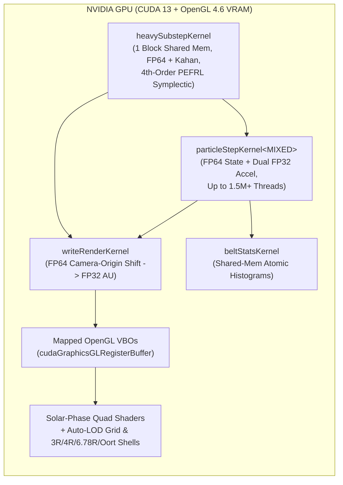

# Substrate Logistics 3D N-Body Simulator

[](https://orcid.org/0009-0003-8413-6027)
[](LICENSE)
[](https://isocpp.org/)
[](https://developer.nvidia.com/cuda-toolkit)
[](https://www.opengl.org/)
[](https://cmake.org/)
[](#7-build--run-instructions)

**Real-Time Bare-Metal Spatial Address Deletion Engine (C++20 / CUDA / OpenGL 4.6)**

An interactive, GPU-accelerated 3D astrophysical laboratory built directly on the **Substrate Logistics** ($`\Omega\mathrm{GLR}`$) theoretical framework by Marco Lindenbeck. Designed as an executable companion and empirical testbed for the foundational Substrate Logistics manuscripts, this engine integrates the coupled **55-body Solar System synchronized to the J2000.0 epoch** (Sun, 8 planets, 23 major moons across Earth, Mars, Jupiter, Saturn, Uranus, Neptune, and Pluto with regular moons rotated into their host planet's true 3D equatorial plane, 11 dwarf planets/TNOs/major asteroids, 3 Centaurs, 2 near-Earth asteroids, 3 Lagrange $`L_4/L_5`$ Trojan exemplars, 2 periodic comets `1P/Halley` and `67P/Churyumov-Gerasimenko`, and hyperbolic interstellar visitor `1I/'Oumuamua`) alongside **3,000 to 1,500,000+ test bodies across 8 authentic dynamical families** (Kirkwood-sculpted Main Belt, Hilda `3:2` Resonant Triangle, Jupiter `L4/L5` Greek & Trojan camps, `3:2` Plutinos, Cold/Hot Classical Kuiper Belts, Scattered Disk, Detached Sednoids, and an isotropic 3D Hills / Inner Oort Cloud spanning `520–16,500 AU`) in real time via zero-copy CUDA–OpenGL VBO interop.

> **Core Distinction:** Unlike planetarium or ephemeris viewers that replay pre-fitted observation tables, and unlike classical N-body solvers built around Newton's empirical gravitational constant $`G`$, **Newton's constant** $`G`$ **and empirical boundary cutoffs do not exist anywhere in this codebase.** Every trajectory, orbital perturbation, perihelion precession, tidal boundary, magnetospheric ring-current limit, and heliospheric ram-pressure boundary emerges from discrete sub-node spatial address deletion and 120-cell topological invariants.

---

## Table of Contents

1. [Why This Engine Is Different: Ephemeris vs. Newtonian vs. Substrate Logistics](#1-why-this-engine-is-different-ephemeris-vs-newtonian-vs-substrate-logistics)
2. [Theoretical Mechanics Executed by the Simulator](#2-theoretical-mechanics-executed-by-the-simulator)
3. [Multi-Scale Topological Drag Pressure Floor: QCD, Magnetospheres, Heliosphere & Galaxies](#3-multi-scale-topological-drag-pressure-floor-qcd-magnetospheres-heliosphere--galaxies)
4. [Scientific Transparency Ledger: Seeded vs. Real-Time Emergent](#4-scientific-transparency-ledger-seeded-vs-real-time-emergent)
5. [Interactive Features, Telemetry & Live Experiments](#5-interactive-features-telemetry--live-experiments)
6. [GPU Architecture & Empirical Benchmarks](#6-gpu-architecture--empirical-benchmarks)
7. [Build & Run Instructions](#7-build--run-instructions)
8. [Theoretical Foundation & Citations](#8-theoretical-foundation--citations)

---

## 1. Why This Engine Is Different: Ephemeris vs. Newtonian vs. Substrate Logistics

Most celestial visualization and simulation tools fall into one of two classical paradigms. This simulator implements a third:

| Architectural Aspect | Ephemeris / Planetarium Software *(SPICE, VSOP87, JPL Horizons, "On-Rails" Animators)* | Standard N-Body Solvers *(Classical Newtonian / 1PN Integrators)* | **Substrate Logistics Engine (`substrate_native`)** |
| :--- | :--- | :--- | :--- |
| **Trajectory Source** | Pre-fitted polynomial lookup tables or closed-form 2-body Keplerian ellipses $`r(\nu(t))`$. | Live numerical integration of continuous gravitational force laws. | **Live symplectic GPU integration** of discrete spatial address deletion; zero lookup tables or scripted orbits. |
| **Gravitational Coupling** | Baked into empirical curve-fits. | Hardcodes **Newton's empirical constant** $`G = 6.67430 \times 10^{-11}\,\mathrm{m^3\,kg^{-1}\,s^{-2}}`$. | **Newton's** $`G`$ **is completely absent.** Uses the bare-metal Substrate Anchor Constant $`\mathcal{K}_\Omega = \bar{\lambda}_p c^2 / \mathcal{T}_\Omega^2`$. |
| **Mass Representation** | Optional or unused for kinematics. | Continuous scalar mass $`M`$ in kilograms. | **Countable integer hadronic load** $`N = M / m_p`$ of saturated 1836-state $`\Gamma`$ knots. |
| **Low-Density Regime** | N/A | Infinite-range $`1/R^2`$ attraction regardless of matter compilation density. | **Heaviside Compilation Filter** $`\Theta(\rho_N - 4.0\,\mathrm{nodes/m^3})`$ separates compiled $`\Gamma`$ knots ($`\Theta = 1`$) from passive $`\mathcal{I}`$ phase gas ($`\Theta = 0`$). |
| **Planetary, Magnetospheric & Heliospheric Scales** | Empirical radii + separate MHD / Voyager curve-fits. | Point masses and arbitrary boundary cutoffs. | Derives **top-down quantum radius** ($`R_\oplus = 6,371.13\,\mathrm{km}`$), **3R / 4R / 6.784R magnetospheric shells** ($`43,222\,\mathrm{km}`$ ring-current limit), **Termination Shock** ($`89.44\,\mathrm{AU}`$), and **Heliopause** ($`120.74\,\mathrm{AU}`$) from bare-metal constants. |

---

## 2. Theoretical Mechanics Executed by the Simulator

In Substrate Logistics, physical space is modeled as a finite-capacity discrete topological network ($`\kappa = 50`$ dodecahedral packing anchored to a closed 120-cell Poincaré Dodecahedral Space manifold $`S^3 / \mathcal{I}^*`$). Gravity is not a gauge force mediated by gravitons ($`E = \hbar\omega`$), but **The Master Regulatory Protocol**: a zero-energy ($`E = 0`$) background memory-management routine that purges un-driven spatial coordinate voxels around compiled matter to prevent localized Bekenstein bandwidth saturation ($`\Omega \ge 1.0`$).

### 2.1. Eradicating Newton's G & Hardware Constants

All gravitational interactions in [`substrate_constants.h`](native_engine/src/substrate_constants.h) and [`substrate_engine.cu`](native_engine/src/substrate_engine.cu) are anchored to sub-node quantum and topological invariants:

* **Single-Proton Informational Load** ($`N = 1`$): $`m_p = 1.6726219 \times 10^{-27}\,\mathrm{kg}`$, mapping any macroscopic mass to its integer baryon node count $`N_{\mathrm{body}} = M / m_p`$.
* **Spatial Pixel Anchor (Reduced Proton Compton Wavelength)**: $`\bar{\lambda}_p = 2.103089 \times 10^{-16}\,\mathrm{m}`$, defining the fundamental voxel volume $`V_{\mathrm{node}} = \bar{\lambda}_p^3 = 9.3019 \times 10^{-48}\,\mathrm{m^3}`$.
* **Master Bus Speed Invariant**: $`c = 299,792,458\,\mathrm{m/s}`$.
* **Universal Attenuation Tensor**: $`\mathcal{T}_\Omega = 1.30147 \times 10^{19}`$ ($`\mathcal{T}_\Omega^2 = 1.69382 \times 10^{38}`$), resolving the $`10^{39}`$ Hierarchy Problem algebraically via the single-proton pixel-to-Schwarzschild ratio $`\bar{\lambda}_p / r_s = \mathcal{T}_\Omega^2 / 2 = 8.4691 \times 10^{37}`$.

From these hardware anchors follow the **Substrate Anchor Constant** ($`\mathcal{K}_\Omega`$) and the exact algebraic **Universal Topological Drag Constant** ($`\mathcal{C}_\delta`$):

$$
\mathcal{K}_\Omega = \frac{\bar{\lambda}_p c^2}{\mathcal{T}_\Omega^2} = 1.11587 \times 10^{-37}\,\frac{\mathrm{m^3}}{\mathrm{node \cdot s^2}}
$$

$$
\mathcal{C}_\delta = \frac{\sqrt{5} - 2}{500} = \frac{\varphi^{-3}}{500} = 4.72135955 \times 10^{-4}, \qquad \sqrt{\mathcal{C}_\delta} = 0.02172869
$$

This fixes the zero-sum 120-cell cosmological cover partitions without free parameters: $`\Omega_{m,\mathrm{void}} = \frac{12}{50} - \sqrt{\mathcal{C}_\delta} = 0.218271`$ ($`\Omega_{\Lambda,\mathrm{void}} = 0.781729`$) and $`\Omega_{m,\mathrm{global}} = \frac{12}{50} + 1.2\sqrt{\mathcal{C}_\delta} = 0.266074`$ ($`\Omega_{\Lambda,\mathrm{global}} = 0.733926`$).

### 2.2. The He-4 Garbage Collection Threshold (4.0 nodes/m³)

Deleted local spatial pointers are recycled into the global 120-cell cover, establishing the resting vacuum energy ledger ($`\Sigma_0`$) across the 5D state-space partition ($`\kappa^5 = 50^5`$):

$$
\Sigma_0 = \frac{2 m_p c^2}{\bar{\lambda}_p^3 \, \mathcal{T}_\Omega^2 \, \kappa^5} = 6.1063 \times 10^{-10}\,\mathrm{J/m^3}
$$

Applying the $`1.7032\%`$ volumetric drag tax across the cell's 36 active routing channels yields $`\Sigma_{0,\mathrm{Ledger}} = 6.0023 \times 10^{-10}\,\mathrm{J/m^3}`$. Dividing by single-node rest energy $`m_p c^2`$ defines the **Garbage Collection Activation Ceiling**:

$$
\rho_{N,\mathrm{GC}} = \frac{\Sigma_{0,\mathrm{Ledger}}}{m_p c^2} = 3.9928 \approx 4.0\,\mathrm{nodes/m^3} \quad \left(\equiv 1\,\mathrm{He^4}\ \alpha\text{-particle}/\mathrm{m^3}\right)
$$

Active spatial address deletion triggers strictly when localized node density saturates all four tetrahedral vector channels ($`\rho_N \ge 4.0\,\mathrm{nodes/m^3}`$). At every symplectic sub-step, the CUDA kernels evaluate:

$$
\mathbf{a}_i = \sum_{j \ne i} \frac{N_j \mathcal{K}_\Omega \, \Theta(\rho_{N,j} - 4.0)}{R_{ij}^2} \left(1 + \frac{3 N_j \mathcal{K}_\Omega}{c^2 R_{ij}}\right) \hat{\mathbf{R}}_{ij}
$$

where $`\Theta(\cdot)`$ is the Heaviside compilation operator and $`1 + \frac{3 N_j \mathcal{K}_\Omega}{c^2 R_{ij}}`$ is the first post-Newtonian (1PN) metric throttling correction responsible for anomalous perihelion precession (reproducing Mercury's observed **`42.96 arcsec/century`** advance in real time).

### 2.3. Discretized River Metric & Spatial Pixel Purge

Freefall acceleration $`g_\Omega(R) = N \mathcal{K}_\Omega \Theta / R^2`$ corresponds to an inward Gullstrand–Painlevé spatial coordinate inflow speed:

$$
v_{\mathrm{inflow}}(R) = \sqrt{2 g_\Omega(R) R} = \sqrt{\frac{2 N \mathcal{K}_\Omega \Theta}{R}}
$$

Across any spherical boundary $`4\pi R^2`$, the engine computes both the volumetric vacuum deletion rate $`\dot{V}_{\mathrm{deleted}} = 4\pi R^2 v_{\mathrm{inflow}}`$ and the **Discrete Spatial Pixel Purge Rate**:

$$
\dot{N}_{\mathrm{pixels}}(R) = \frac{4\pi R^2 v_{\mathrm{inflow}}(R)}{\bar{\lambda}_p^3}
$$

For Earth ($`N_\oplus = 3.5706 \times 10^{51}\,\mathrm{nodes}`$, $`R_\oplus = 6,371.0\,\mathrm{km}`$), the simulator evaluates $`v_{\mathrm{inflow}} = 11.186\,\mathrm{km/s}`$ and $`\dot{N}_{\mathrm{pixels}} = 6.1325 \times 10^{65}\,\mathrm{pixels/s}`$ live.

### 2.4. Pythagorean Bandwidth Governor & Atomic Clock CPU Throttling

Each metric cell operates under the **Absolute Bandwidth Invariant**:

$$
\Omega(R) = g_{\Omega,\mathrm{river}}^2 + \alpha_\Omega^2 + v_\Omega^2 \le 1.0, \qquad u_\Omega(R) = \sqrt{1.0 - \Omega(R)}
$$

where $`g_{\Omega,\mathrm{river}} = v_{\mathrm{inflow}} / c = \sqrt{2 N \mathcal{K}_\Omega / (c^2 R)}`$ and $`v_\Omega = v / c`$.
* When $`\Omega \to 1.0`$ at $`R_{\mathrm{EH}} = \frac{2 N \bar{\lambda}_p}{\mathcal{T}_\Omega^2}`$, residual bandwidth $`u_\Omega \to 0`$, triggering an **OS Kernel Lock** (Event Horizon).
* In weak fields, $`1 - u_\Omega(R) \approx \frac{N \mathcal{K}_\Omega}{c^2 R} + \frac{v^2}{2 c^2}`$ measures literal **hardware CPU clock throttling** of hyperfine atomic transitions (`0.6958 ppb` or `-60.12 µs/day` on Earth's surface relative to deep void).

### 2.5. Macro-Scale Quantization & 3R / 4R / 6.784R Magnetospheric Shells

From each body's collective Compton resolution floor $`\bar{\lambda}_{\mathrm{body}} = \bar{\lambda}_p / N_{\mathrm{body}}`$, the telemetry engine verifies the parameter-free **Top-Down Quantum Boundary Identity**:

$$
R_{\mathrm{quantum}} = \frac{c \cdot \bar{\lambda}_p}{\mathcal{T}_\Omega \sqrt{\bar{\lambda}_{\mathrm{body}} \cdot g_{\Omega,\mathrm{surface}}}}
$$

evaluating to **`6,371.13 km`** for Earth (`0.002%` from Earth's `6,371.00 km` mean volumetric radius). Scaling the sub-node 3-channel directional mass extension ($`3\bar{\lambda}_p = 0.6309\,\mathrm{fm}`$), 4-channel electromagnetic charge boundary ($`4\bar{\lambda}_p = 0.8412\,\mathrm{fm}`$), and 3D central-body stagnation multiplier ($`\mathcal{C}_\delta^{-1/4} \bar{\lambda}_p = 6.78396 \, \bar{\lambda}_p = 1.4267\,\mathrm{fm}`$) upward to macroscopic planetary radii maps directly onto planetary magnetospheres:
* **1R Core Boundary** ($`1 R_{\mathrm{body}}`$): Bare-metal compressed solid/fluid core boundary (`6,371 km` for Earth).
* **3R Axial Vector Shell** ($`3 R_{\mathrm{body}}`$): 3D directional vector extension delta (`19,113 km` — Earth's surface-to-Plasmapause altitude).
* **4R Electromagnetic Shell** ($`4 R_{\mathrm{body}}`$): Total unspooled 4-channel electromagnetic boundary (`25,484 km` — Plasmapause / inner Van Allen radiation belt radius).
* **6.784R Ring-Current Stagnation Limit** ($`\mathcal{C}_\delta^{-1/4} R_{\mathrm{body}} = 6.78396 R_{\mathrm{body}}`$): Outer dipolar magnetic energy density stagnation boundary (`43,221 km` radius / McIlwain `L = 6.784 R_Earth` adiabatic ring-current trapping limit, right inside geostationary orbit `6.6 R_Earth`).

---

## 3. Multi-Scale Topological Drag Pressure Floor: QCD, Magnetospheres, Heliosphere & Galaxies

Because energy density is dimensionally identical to mechanical pressure ($`1\,\mathrm{J/m^3} \equiv 1\,\mathrm{N/m^2} \equiv 1\,\mathrm{Pa}`$), multiplying the Substrate's two fundamental energy-density ledgers by the exact algebraic **Universal Topological Drag constant** $`\mathcal{C}_\delta = (\sqrt{5} - 2)/500 = 4.72135955 \times 10^{-4}`$ defines two parameter-free stagnation pressure floors and three universal dimensionless stagnation operators across **38 orders of magnitude**:

$$
\mathcal{C}_\delta^{1/4} = 0.1474065, \qquad \mathcal{C}_\delta^{-1/4} = 6.7839605, \qquad \frac{1}{2}\ln\!\left(\frac{1}{\mathcal{C}_\delta}\right) = 3.829119
$$

### 3.1. Regime I (Subatomic): MIT Bag Constant, Yukawa Range & 138.3 MeV Pion Mass

At the sub-node hadronic saturation ceiling $`\varepsilon_{\max} = m_p c^2 / \bar{\lambda}_p^3 = 1.6161 \times 10^{37}\,\mathrm{Pa}`$ ($`100.869\,\mathrm{GeV/fm^3}`$), the micro-scale topological drag pressure floor is:

$$
P_{\delta,\mathrm{micro}} = \mathcal{C}_\delta \cdot \varepsilon_{\max} = \left(\frac{\sqrt{5} - 2}{500}\right) \frac{m_p c^2}{\bar{\lambda}_p^3} = 7.6302 \times 10^{33}\,\mathrm{Pa} = 47.624\,\mathrm{MeV/fm^3} \quad \left(B_{\mathrm{QCD}}^{1/4} = 145.0\,\mathrm{MeV}\right)
$$

reproducing the canonical **MIT Bag Constant** ($`B_{\mathrm{QCD}}^{1/4} \approx 145\,\mathrm{MeV}`$). Applying the 3D central-source stagnation operator $`\mathcal{C}_\delta^{\pm 1/4}`$ to the proton anchor yields the **Yukawa strong-force range** and **Pion mass** without free parameters:

$$
R_{\delta,p} = \mathcal{C}_\delta^{-1/4} \bar{\lambda}_p = 6.78396 \times 0.210309\,\mathrm{fm} = 1.4267\,\mathrm{fm}, \qquad m_\pi = m_p \, \mathcal{C}_\delta^{1/4} = 938.272 \times 0.1474065 = 138.31\,\mathrm{MeV/c^2}
$$

matching the observed pion multiplet ($`m_{\pi^0} = 134.98\,\mathrm{MeV/c^2}`$, $`m_{\pi^\pm} = 139.57\,\mathrm{MeV/c^2}`$, spin-isospin centroid `138.04 MeV/c^2`) to **`99.81%`**.

### 3.2. Regime III (Heliospheric): Voyager 1/2 Ram-Pressure Balance & Outer Oort Core

At the cosmic cover scale, multiplying the Global Resting Cover Ledger $`\Sigma_{0,\mathrm{Ledger}} = 6.0023 \times 10^{-10}\,\mathrm{Pa}`$ by $`\mathcal{C}_\delta`$ isolates the macroscopic **Topological Drag Pressure Floor** ($`P_\delta`$):

$$
P_{\delta,\mathrm{macro}} = \mathcal{C}_\delta \cdot \Sigma_{0,\mathrm{Ledger}} = \left(\frac{\sqrt{5} - 2}{500}\right) \Sigma_{0,\mathrm{Ledger}} = 2.8339 \times 10^{-13}\,\mathrm{Pa} \quad \left(0.2834\,\mathrm{pPa}, \quad P_\delta / k_B = 2.053 \times 10^4\,\mathrm{K\,cm^{-3}}\right)
$$

In-situ plasma and magnetic field measurements from **Voyager 2** combined with **IBEX** energetic neutral atom (ENA) global sky maps place the total Very Local Interstellar Medium (VLISM) confining pressure outside the Heliopause at **`0.26–0.29 pPa`** ($`2.6 \times 10^{-13}`$ to $`2.9 \times 10^{-13}\,\mathrm{Pa}`$) — matching $`P_\delta = 0.2834\,\mathrm{pPa}`$ squarely within observational uncertainty.

Balancing the supersonic solar wind's radial ram pressure $`P_{\mathrm{SW}}(R) = m_p n_{\mathrm{SW}}(1\,\mathrm{AU}) v_{\mathrm{SW}}^2 (1\,\mathrm{AU} / R)^2`$ (using the long-term ACE/Wind solar-cycle mean at $`1\,\mathrm{AU}`$: $`n_{\mathrm{SW}} \approx 7.0\,\mathrm{cm^{-3}}`$, $`v_{\mathrm{SW}} \approx 440\,\mathrm{km/s} \Rightarrow P_{\mathrm{SW}}(1\,\mathrm{AU}) = 2.2667\,\mathrm{nPa}`$) against $`P_\delta`$ yields the **Termination Shock** and Rankine–Hugoniot **Heliopause nose** ($`R_{\mathrm{HP}} = 1.35 R_{\mathrm{TS}}`$):

$$
R_{\mathrm{TS}} = 1\,\mathrm{AU} \sqrt{\frac{m_p n_{\mathrm{SW}}(1\,\mathrm{AU}) v_{\mathrm{SW}}^2}{\mathcal{C}_\delta \cdot \Sigma_{0,\mathrm{Ledger}}}} = 89.44\,\mathrm{AU}, \qquad R_{\mathrm{HP}} = 1.35 \, R_{\mathrm{TS}} = 120.74\,\mathrm{AU}
$$

bracketing **Voyager 2 (`83.7 AU` shock / `119.0 AU` heliopause)** and **Voyager 1 (`94.0 AU` shock / `121.6 AU` heliopause)**. Evaluating the Sun's outer **Gravitational Deletion Floor** $`R_g(N_\odot)`$ where $`u_g(R) = \frac{m_p g_\Omega(R)^2}{8\pi \mathcal{K}_\Omega}`$ drops to $`\Sigma_{0,\mathrm{Ledger}}`$ and applying $`\mathcal{C}_\delta^{-1/4}`$ defines the **Inner and Outer Oort Cloud core transitions**:

$$
R_g(N_\odot) = \left( \frac{m_p N_\odot^2 \mathcal{K}_\Omega}{8\pi \Sigma_{0,\mathrm{Ledger}}} \right)^{1/4} = 2,430.82\,\mathrm{AU}, \qquad R_{\delta,\odot} = \mathcal{C}_\delta^{-1/4} R_g(N_\odot) = 6.78396 \, R_g(N_\odot) = 16,490.6\,\mathrm{AU}
$$

Crucially, because $`u_g(R)`$ remains above $`\Sigma_{0,\mathrm{Ledger}}`$ all the way out to `2,430.82 AU`, every planetary, Kuiper Belt, and detached TNO orbit inside `1,000 AU` resides strictly inside the compiled $`\Theta = 1`$ inverse-square regime — requiring **zero changes** to the GPU Velocity-Verlet force law.

### 3.3. Regime IV (Galactic): 2D Exponential Disk Stagnation Law & Fermi/eROSITA Bubbles

Unlike a 3D central monopole ($`u(R) \propto R^{-4}`$), a flattened galactic stellar disk follows a 2D exponential surface-density profile $`\Sigma(R) = \Sigma_{\mathrm{central}} e^{-R/R_d}`$ whose vertical gravitational restoring pressure scales as $`P_{\mathrm{disk}}(R) \propto \Sigma(R)^2 = P_{\mathrm{disk}}(0) e^{-2R/R_d}`$. Stagnation against the topological drag floor $`P_{\mathrm{disk}}(R_{\mathrm{trunc}}) = \mathcal{C}_\delta P_{\mathrm{disk}}(0)`$ yields the universal **2D Exponential Disk Truncation Ratio**:

$$
\frac{R_{\mathrm{trunc}}}{R_d} = \frac{1}{2} \ln\!\left(\frac{1}{\mathcal{C}_\delta}\right) = \frac{1}{2} \ln\!\left(\frac{500}{\sqrt{5}-2}\right) = 3.8291
$$

matching the observed edge-on spiral galaxy truncation distribution **`R_trunc / R_d = 3.8 ± 0.7`** (`Kregel, van der Kruit & de Grijs 2002`) without dark-matter halo fitting. For the Milky Way ($`R_d \approx 2.85\,\mathrm{kpc} \Rightarrow R_{\mathrm{trunc}} \approx 10.91\,\mathrm{kpc}`$), the 3-channel (`3 R_0 = 8.55 kpc`) and 4-channel (`4 R_0 = 11.40 kpc`) vertical outflow harmonics match the **Fermi gamma-ray bubbles (`≈ 8.5 kpc`)** and **eROSITA X-ray bubbles (`≈ 11–14 kpc`)** confined by $`P_{\delta,\mathrm{macro}} = 0.2834\,\mathrm{pPa}`$.

### 3.4. Summary of Parameter-Free Cross-Scale Predictions (38 Orders of Magnitude)

| Regime & Observable | Substrate Operator | Derived Value | Observational / Empirical Benchmark |
| :--- | :--- | :--- | :--- |
| **I. MIT Bag Constant** ($`B_{\mathrm{QCD}}`$) | $`\mathcal{C}_\delta \, m_p c^2 / \bar{\lambda}_p^3`$ | **`47.624 MeV/fm³`** (`7.630e33 Pa`) | $`B^{1/4} = 145.0\,\mathrm{MeV}`$ (MIT Bag Model) |
| **I. Strong-Force Yukawa Range** ($`R_{\delta,p}`$) | $`\mathcal{C}_\delta^{-1/4} \bar{\lambda}_p`$ | **`1.4267 fm`** | `1.414–1.430 fm` nucleon-nucleon range |
| **I. Pion Mass** ($`m_\pi`$) | $`m_p \, \mathcal{C}_\delta^{1/4}`$ | **`138.31 MeV/c²`** | `138.04 MeV/c²` multiplet (`99.81%` match) |
| **II. Earth Plasmapause / Van Allen** | $`3 R_\oplus`$ / $`4 R_\oplus`$ | **`19,113 km`** / **`25,484 km`** | Plasmapause altitude / Van Allen belt |
| **II. Earth Ring-Current Trapping Limit** | $`\mathcal{C}_\delta^{-1/4} R_\oplus = 6.784 R_\oplus`$ | **`43,221 km`** (`L = 6.784`) | Outer storm-time ring current / GEO (`6.6 R_E`) |
| **III. Macro Drag Floor** ($`P_{\delta,\mathrm{macro}}`$) | $`\mathcal{C}_\delta \, \Sigma_{0,\mathrm{Ledger}}`$ | **`0.2834 pPa`** (`2.053e4 K cm⁻³`) | `0.26–0.29 pPa` (Voyager 2 / IBEX VLISM) |
| **III. Solar Wind Termination Shock** ($`R_{\mathrm{TS}}`$) | $`1\,\mathrm{AU}\sqrt{P_{\mathrm{SW}}(1\,\mathrm{AU}) / P_\delta}`$ | **`89.44 AU`** | `83.7 AU` (Voyager 2) – `94.0 AU` (Voyager 1) |
| **III. Solar Wind Heliopause Nose** ($`R_{\mathrm{HP}}`$) | $`1.35 \, R_{\mathrm{TS}}`$ | **`120.74 AU`** | `119.0 AU` (Voyager 2) – `121.6 AU` (Voyager 1) |
| **III. Solar Gravitational Floor & Oort Core** | $`R_{g,\odot}`$ / $`6.784 R_{g,\odot}`$ | **`2,430.8 AU`** / **`16,490.6 AU`** | Inner Hills cloud / Outer Oort core transition |
| **IV. 2D Galactic Disk Truncation** | $`\frac{1}{2}\ln(1/\mathcal{C}_\delta)`$ | **`3.829 R_d`** | `3.8 ± 0.7 R_d` edge-on spiral survey mean |
| **IV. Milky Way Fermi / eROSITA Bubbles** | $`3 R_0`$ / $`4 R_0`$ in $`P_\delta`$ | **`8.55 kpc`** / **`11.40 kpc`** | `~8.5 kpc` (Fermi) / `~11–14 kpc` (eROSITA) |

---

## 4. Scientific Transparency Ledger: Seeded vs. Real-Time Emergent

To guarantee complete scientific auditability, below is the exact boundary between what is supplied at initialization ($`t = 0`$) and what is computed dynamically at runtime ($`t \gt 0`$).

### 4.1. Universal Hardware Constants

Only the global Substrate constants ($`m_p`$, $`\bar{\lambda}_p`$, $`c`$, $`\mathcal{T}_\Omega`$, $`\kappa = 50`$, $`\Delta_{\mathrm{tax}} = 1.7032\%`$, exact $`\mathcal{C}_\delta = (\sqrt{5} - 2)/500`$, and the derived stagnation operators $`\mathcal{C}_\delta^{\pm 1/4}`$ and $`\frac{1}{2}\ln(1/\mathcal{C}_\delta)`$) plus standard unit conversions (`AU`, `Mpc`) exist in [`substrate_constants.h`](native_engine/src/substrate_constants.h). Zero empirical astronomical boundary constants (such as `121.6 AU`) exist in the header.

### 4.2. Initial Boundary Conditions at t = 0 Only

Configured once at startup in [`payload.cpp`](native_engine/src/payload.cpp):
1. **55 Mutually Coupled Heavy Bodies (Synchronized to J2000.0 Epoch: 2000-Jan-01 12:00 TT)** — Sun, Mercury, Venus, Earth + Moon, Mars + Phobos/Deimos, Jupiter + Io/Europa/Ganymede/Callisto, Saturn + Titan/Mimas/Enceladus/Tethys/Dione/Rhea/Iapetus, Uranus + Miranda/Ariel/Umbriel/Titania/Oberon, Neptune + retrograde Triton/Proteus/Nereid, Main Belt asteroids Ceres/Vesta/Pallas/Hygiea, Pluto + Charon, trans-Neptunian dwarfs Haumea/Makemake/Eris/Sedna/`50000 Quaoar`/`225088 Gonggong`/`90482 Orcus`, outer-system Centaurs `2060 Chiron`/`10199 Chariklo`/`5145 Pholus`, near-Earth asteroids `99942 Apophis`/`101955 Bennu`, Lagrange exemplars `588 Achilles (Jup L4)`, `617 Patroclus (Jup L5)`, `2010 TK7 (Earth L4)`, periodic comets `1P/Halley` and `67P/Churyumov-Gerasimenko`, and hyperbolic interstellar visitor `1I/'Oumuamua` ($`a = -1.2798\,\mathrm{AU}`$, $`e = 1.20113`$, $`v_\infty = 26.32\,\mathrm{km/s}`$):
   * **Physical Mass** $`M`$ (kg) $`\Rightarrow`$ converted at load into integer node count $`N = M / m_p`$.
   * **Physical Mean Volumetric Radius** $`R`$ (m) $`\Rightarrow`$ converted into volume $`V = \frac{4}{3}\pi R^3`$ and base node density $`\rho_N = N / V`$.
   * **J2000.0 Orbital Placement & True Equatorial Moon Alignment** $`(a_0, e_0, i_0, \Omega_0, \omega_0, \nu_0)`$ $`\Rightarrow`$ evaluated **once at startup** into 3D Cartesian state vectors $`(\mathbf{r}_0, \mathbf{v}_0)`$ using exact mutual two-body + oblate $`J_2`$ parameters $`\mu = ((M_{\mathrm{parent}} + M_{\mathrm{child}})/m_p) \mathcal{K}_\Omega [1 + \frac{3}{2}J_2(R_p/a)^2]`$ (without $`G`$). Regular equatorial moons of Mars (`25.19°`), Jupiter (`3.13°`), Saturn (`26.73°`, including Titan), Uranus (`97.77°`), and Neptune (`28.32°`, including retrograde Triton and Proteus) are rotated directly into their parent planet's 3D spin-axis equatorial frame (`rotateFromParentEquator`) so they align cleanly with the parent's $`J_2`$ bulge, while outer Laplace-plane moons (`Moon`, `Iapetus`, `Charon`, `Nereid`) remain in the ecliptic frame. All local planet–moon subsystem barycenters and the global Solar System barycenter are balanced at load, after which initial elements are **discarded**.
   * **Axial Rotation & Moment of Inertia**: Free rotators (Sun, planets, dwarf planets, asteroids, Centaurs, comets, and eccentric outer moon `Nereid` at `11.594 h`) seed their initial sidereal rotation period, axial obliquity $`\varepsilon`$, and dimensionless polar moment of inertia $`C / (M R^2)`$; all **22 regular/locked moons** use `tidalLockMode = 1` (`1:1` synchronous lock) and **Mercury** uses `tidalLockMode = 2` (`3:2` spin-orbit resonance) so their rotation periods and spin axes emerge dynamically from their live orbits.
   * **Visual Metadata**: Display name, parent body identifier (used only to select the reference body for relative inspector telemetry), RGB color, and sprite pixel diameter.
2. **3,000 – 1,500,000 Test Particles Across 8 Authentic Dynamical Families**:
   * **Kirkwood-Sculpted Main Asteroid Belt** (`2.10–3.26 AU`, 80% of `numAsteroids`): Partitioned into Inner (Flora/Vesta, `2.10–2.50 AU`), Middle (Eunomia/Maria, `2.50–2.825 AU`), and Outer (Koronis/Themis/Hygiea, `2.825–3.26 AU`) zones with inverted Gaussian rejection notches across J2000.0 Jupiter's `4:1`, `3:1`, `5:2`, `7:3`, and `2:1` mean-motion resonances.
   * **Hilda 3:2 Resonant Triangle** (`a ≈ 3.971 AU`, 8% of `numAsteroids`): Phase-correlated longitude of perihelion $`\varpi = 3\lambda_{\mathrm{Jup}} - 3M + \delta\phi`$ synchronized to J2000.0 Jupiter ($`\lambda_{\mathrm{Jup}} = 34.39644^\circ`$), forming the equilateral 3-fold Hilda triangle with aphelia at Jupiter's $`L_4, L_5, L_3`$ zones.
   * **Jupiter L4 (`+60°` Greek Camp) & L5 (`-60°` Trojan Camp) Swarms** (`a ≈ 5.2029 AU`, 12% of `numAsteroids`): Synchronized to J2000.0 Jupiter and librating naturally in tadpole orbits around the Sun–Jupiter triangular Lagrange points with zero artificial rotating-frame constraints.
   * **Outer Trans-Neptunian & Hills / Inner Oort Cloud Populations** (`numKBOs`): **3:2 Resonant Plutinos** (`39.1–39.8 AU`, 17%), **Cold Classical Kuiper Belt** (`42.0–47.6 AU`, $`\sigma_i = 2.2^\circ`$, terminating sharply at Neptune's `2:1` cliff at `47.8 AU`, 42%), **Hot Classical Kuiper Belt** (`40.2–47.6 AU`, $`\sigma_i = 13.5^\circ`$, 21%), **Scattered Disk** (`48.0–72.0 AU`, 10%), **Detached Sednoids** (`75.0–520.0 AU`, $`q \in [42, 80]\,\mathrm{AU}`$ spanning the `89.44 AU` Termination Shock and `120.74 AU` Heliopause, 5%), and an isotropic 3D **Hills / Inner Oort Cloud** (`520–16,500 AU`, log-uniform $`a`$, $`q \in [60, 2,400]\,\mathrm{AU}`$, $`\cos i \sim \mathcal{U}(-1, 1)`$, Kepler mean-anomaly sampling, 5%).

### 4.3. Computed 100% Live at Runtime

Executed continuously in [`substrate_engine.cu`](native_engine/src/substrate_engine.cu) and [`astro_metrics.cpp`](native_engine/src/astro_metrics.cpp):
* **All 3D Positions, Velocities & Accelerations**: Integrated every frame on the GPU via **4th-order Omelyan PEFRL symplectic composition with Kahan–Babuška–Neumaier compensated summation and dynamic CFL frequency subdivision** for all 55 mutually coupled heavy bodies (`heavySubstepKernel`) and 2nd-order symplectic Velocity Verlet for test particles (`particleStepKernel`).
* **Garbage Collection Gate** $`\Theta(\rho_N - 4.0)`$: Evaluated dynamically; overriding $`\rho_N \lt 4.0\,\mathrm{nodes/m^3}`$ updates `d_mu` in GPU memory and physically unbinds satellites in real time.
* **Dynamic Heliospheric Ram-Pressure Boundaries & Oort Floor**: `terminationShockRadiusAU()` (`89.44 AU`), `heliopauseRadiusAU()` (`120.74 AU`), `gravitationalFloorAU()` (`2,430.82 AU`), and `outerOortStagnationAU()` (`16,490.6 AU`) are evaluated live (collapsing dynamically to `0` if the Sun is decompiled below `4.0 nodes/m^3` in the GC Sandbox).
* **Osculating Keplerian Elements**: $`(a, e, i, \Omega, \omega, \nu, q, Q, T)`$ are **reverse-computed every frame** from raw instantaneous GPU $`(\mathbf{r}(t), \mathbf{v}(t))`$ vectors, capturing live multi-body perturbations as well as unbound hyperbolic flybys (`1I/'Oumuamua`).
* **Emergent 3D Lagrange Points ($`L_1\text{–}L_5`$)** (`computeLagrangePoints()`): Solves the exact restricted three-body Euler quintic via 12 Newton–Raphson iterations for collinear $`L_1, L_2, L_3`$ and constructs equilateral $`L_4, L_5`$ in the target's instantaneous orbital plane from live GPU state and $`\mu`$ values — vanishing immediately if either body is decompiled ($`\Theta = 0`$) in the GC Sandbox.
* **Substrate Hardware Telemetry & Darwin–Radau Quadrupole ($`J_2`$)**: River inflow $`v_{\mathrm{inflow}}`$, volumetric deletion $`\dot{V}`$, discrete pixel purge $`\dot{N}_{\mathrm{pixels}}`$, top-down quantum radius $`R_{\mathrm{quantum}}`$, Schwarzschild Kernel Lock horizon $`R_{\mathrm{EH}}`$, surface, equatorial-spin & orbital clock dephasing $`(1 - u_\Omega)`$, emergent `1:1` / `3:2` tidal spin periods, River-Metric centrifugal ratio $`q_{\mathrm{rot}} = 2(v_{\mathrm{eq}} / v_{\mathrm{inflow}})^2`$, hydrostatic Darwin–Radau quadrupole $`J_2`$ & polar flattening $`1/f`$, and both 1PN relativistic and $`J_2`$ quadrupole apsidal/nodal precession rates.
* **Gravitational/Tidal Domains, Tilted 3D Spin Axes & Orbit Trails**: Hill sphere $`r_H`$, Laplace SOI $`r_{\mathrm{SOI}}`$, fluid & rigid Roche limits $`d_R`$, $`1R / 3R / 4R / 6.784R`$ magnetospheric shells tilted to each body's live 3D spin axis $`\hat{\mathbf{s}}`$ (with a North–South pole vector and rotating prime-meridian spoke), heliospheric $`R_{\mathrm{TS}} / R_{\mathrm{HP}} / R_g`$ & Outer Oort Core ($`6.784 R_g = 16,490.6\,\mathrm{AU}`$) shells, and parent-relative angular-stepped 3D orbit trails.
* **Zero-Readback GPU Belt Histograms**: A dedicated shared-memory atomic CUDA kernel (`beltStatsKernel`) bins semi-major axis $`a`$ (`1.90–5.50 AU` and `30.0–72.0 AU`), eccentricity $`e`$, and Jupiter Tisserand invariant $`T_J`$ directly in VRAM, while Kirkwood (`3:1`, `5:2`, `2:1`), `3:2 Hilda`, `1:1 Trojan (L4/L5)`, and Neptune (`3:2` Plutino at `39.4 AU`, `2:1` Twotino cliff at `47.8 AU`) resonance markers are computed live from Jupiter and Neptune's instantaneous semi-major axes.
* **Static Reference Values Note**: In Tab 1 Section D, the cosmic-scale $`H_0`$ (`59.61 / 67.42 / 73.06 km/s/Mpc`) and $`S_8`$ (`0.7542 -> 0.8326`) partitions are shown as static 120-cell manifold reference constants (since the simulation volume spans a single planetary system rather than a multi-Mpc cosmic web).

---

## 5. Interactive Features, Telemetry & Live Experiments

### 5.1. Viewport Navigation, Solar Phase Lighting, Auto-LOD Grid & Smart HUD
* **Camera Controls**:
  * **Left-Click + Drag**: Orbit azimuth & elevation around current focus.
  * **Mouse Wheel** *(or Right-Click + Drag)*: Continuous zoom across **9+ orders of magnitude** — from `25,000 AU` (framing the entire Hills / Inner Oort Cloud and the Outer Oort Stagnation Core at $`6.784 R_g = 16,490.6\,\mathrm{AU}`$) down to `1.0e-5 AU` (`≈ 1,500 km`, inner planetary magnetospheres and Martian moons) with zero floating-point jitter.
  * **Middle-Click + Drag**: Pan camera target.
  * **Click Any Object or HUD Label**: Directly selects that star, planet, dwarf planet, or moon in the Inspector.
  * **`F2` Key**: Toggles the floating **Astrophysics & Substrate Telemetry** window.
* **True Dynamic 3D Solar Phase Lighting**: Instanced planetary/lunar sphere shaders compute the live view-space Sun direction (`uSunPos - aPos`) per body each frame so inner planets display real crescents and moons display authentic astronomical illumination phases as they orbit.
* **Multi-Scale Auto-LOD Reference Grid**: A unit `±10` reference grid cross-fades two power-of-10 octaves smoothly across 9 orders of magnitude — anchoring to the locked target's local XY plane below `0.25 AU` (kilometer-scale moon grids) and to the Sun's ecliptic plane out to `25,000 AU`.
* **Live Emergent `L1–L5` Lagrange Point Overlay**: Toggleable via **`Show Lagrange Points (L1-L5) for Target`**, rendering subtle emerald `Parent -> L4/L5 -> Target` equilateral guide triangles plus gold (`L1–L3`) and emerald-cyan (`L4–L5`) diamond reticles around any active planet, dwarf planet, or moon.
* **Hierarchical Label Deconfliction**:
  * At solar-system zoom levels, close moon systems automatically fold into clean parent badges (`Jupiter (+4)`, `Saturn (+7)`, `Uranus (+5)`, `Neptune (+3)`, `Mars (+2)`, `Pluto (+1)`) so satellite names never obscure planetary labels.
  * When zoomed into a planetary system or inspecting a planet/moon, labels expand with 2D AABB collision avoidance and radial leader-line callouts.

### 5.2. Four-Tab Floating Telemetry Window (`Astrophysics & Substrate Telemetry`)
1. **`1. Substrate Audit`**: Live surface & orbital River Metric inflow and pixel purge rates, Bandwidth Governor $`\Omega`$ & atomic clock lag (`ppb` and `µs/day`), 1PN perihelion precession, collective Compton floor & top-down quantum radius check, $`1R / 3R / 4R / 6.784R`$ magnetospheric shells, coarse-grained volume probe (`1–20,000 AU`), and the **Topological Drag Pressure Floor ($`P_\delta`$) — 4-Regime Hardware Audit** (Regime I QCD/Pion, Regime II Planetary `6.784R` Magnetosphere, Regime III Solar Wind Ram-Pressure Balance with live `n_SW` / `v_SW` sliders, and Regime IV Galactic `3.829 R_d` Disk Truncation & Fermi/eROSITA Bubbles).
2. **`2. Astrodynamics & Conservation`**: Live osculating 3D Keplerian elements (including hyperbolic escape telemetry for `1I/'Oumuamua`), Hill sphere, Laplace SOI, Fluid/Rigid Roche limits, and rolling sparkline graphs of relative mechanical energy drift $`\lvert (E - E_0)/E_0 \rvert`$ and angular momentum drift $`\lvert (\lVert\mathbf{L}\rVert - \lVert\mathbf{L}_0\rVert)/\lVert\mathbf{L}_0\rVert \rvert`$.
3. **`3. Belt Resonances (GPU)`**: Real-time GPU-binned histograms of Inner System (`1.90–5.50 AU`: Main Belt Kirkwood gaps, `3:2` Hildas & `1:1` Jupiter Trojans) and Kuiper Belt + Scattered Disk (`30–72 AU`) semi-major axes with live Kirkwood (`3:1, 5:2, 2:1`), `3:2 Hilda`, `1:1 Trojan (L4/L5)`, and Neptune (`3:2 Plutino`, `2:1 Cliff`) resonance markers, eccentricity distribution, and Jupiter Tisserand parameter ($`T_J`$) dynamical classification.
4. **`4. GC Sandbox (Theta Filter)`**: Interactive node-density override slider spanning $`10^{-2}`$ to $`10^{32}\,\mathrm{nodes/m^3}`$ to test the $`\rho_{N,\mathrm{GC}} = 4.0\,\mathrm{nodes/m^3}`$ compilation threshold live on the GPU.

### 5.3. Five Recommended Live Experiments
1. **Unbinding Jupiter's Moons Across the 4.0 nodes/m³ Compilation Threshold**:
   * Select **Jupiter**, click **`Zoom: Moon / Hill System`** in the Control Center, and watch `Io`, `Europa`, `Ganymede`, and `Callisto` trace closed orbital rings inside Jupiter's amber Hill sphere.
   * Open **Tab 4 (`GC Sandbox`)** and click **`Decompile -> I-Phase (1.2 nodes/m^3, Theta = 0)`**.
   * Because $`\rho_N \lt 4.0\,\mathrm{nodes/m^3}`$, $`\Theta_{\mathrm{Jupiter}}`$ flips to `0` on the GPU, shutting off Jupiter's active spatial address deletion ($`g_\Omega = 0`$) and instantly collapsing Jupiter's emergent `L1–L5` Lagrange markers. All four Galilean moons immediately transition onto straight tangential escape trajectories into heliocentric space! Click **`Reload Pristine Solar System Orbits`** to restore the system.
2. **Inspecting the Heliospheric Ram-Pressure Termination Shock (`89.44 AU`), Heliopause (`120.74 AU`) & Outer Oort Core (`16,491 AU`)**:
   * Click **`Zoom: Heliosphere (TS 89.4 AU / HP 120.7 AU)`** in the Control Center to frame the amber Termination Shock ring (`89.44 AU`) and blue Heliopause wireframe sphere (`120.74 AU`) derived from $`P_{\mathrm{SW}}(R) = P_\delta = 0.2834\,\mathrm{pPa}`$.
   * Open **Tab 1 (`1. Substrate Audit`)** and adjust the **Solar Wind `n(1 AU)` and `v_SW`** sliders to watch the Termination Shock and Heliopause expand and contract dynamically across the Voyager 1 and Voyager 2 crossing radii.
   * Click **`Zoom: Outer Oort Core (16,491 AU)`** to pull out across the isotropic 3D Hills / Inner Oort Cloud and frame both the Solar Gravitational Floor $`R_g`$ (`2,430.8 AU`) and Outer Oort Core $`6.784 R_g`$ (`16,490.6 AU`) wireframe shells.
3. **Inspecting Earth's 3R Plasmapause, 4R Van Allen & 6.784R Ring-Current Shells**:
   * Select **Earth** and click **`Zoom: 3R/4R/6.78R Magnetosphere`**.
   * Observe the nested $`1R`$ core ring (`6,371 km`), electric-cyan $`3R`$ **directional mass/axial wireframe shell** (`19,113 km`), violet $`4R`$ **unspooled 4-channel boundary** (`25,484 km`), and gold $`6.784R`$ **outer ring-current trapping ring** (`43,221 km`), while verifying `Top-Down Quantum Radius: 6371.13 km` in Tab 1.
4. **Observing Phobos Inside Mars's Fluid Roche Limit**:
   * Select **Phobos** and click **`Zoom: Moon / Hill System`** (then scroll in slightly toward Mars).
   * Notice Phobos (`a = 9,376 km`, orbiting cleanly in Mars's `25.19°` tilted equatorial plane) visibly **inside** Mars's crimson **Fluid Roche Limit** ring (`10,775 km`, `r / d_R = 0.870`), flagged in Tab 2 as tidally stressed above the rigid-body rubble-pile limit (`5,563 km`).
5. **Tracking Emergent `L4/L5` Trojan Libration & Hyperbolic `1I/'Oumuamua` Flyby**:
   * Select **Jupiter** at ~`18 AU` zoom with **`Show Lagrange Points (L1-L5) for Target`** enabled to watch `588 Achilles`, `617 Patroclus`, and the emerald Greek/Trojan particle clouds librate naturally around the live equilateral `L4`/`L5` reticles.
   * Select **`1I/'Oumuamua`** to follow its high-inclination (`122.74°`), inbound hyperbolic perihelion passage (`e = 1.20113`, `v_inf = 26.32 km/s`) through the inner Solar System under pure $`\mathcal{K}_\Omega`$ spatial address deletion.

---

## 6. GPU Architecture & Empirical Benchmarks



### Key Numerical & Rendering Optimizations
* **4th-Order Omelyan PEFRL + Kahan–Babuška + Dynamic CFL Sub-Stepping**: All 55 mutually coupled heavy bodies execute Omelyan's 4th-order Position-Extended Forest-Ruth-Like (`PEFRL`) 5-Drift, 4-Kick symplectic composition inside **one thread block** (`__shared__` memory) with Kahan–Babuška–Neumaier compensated summation (`106-bit` effective mantissa in registers) and **instantaneous Courant–Friedrichs–Lewy (CFL) dynamical frequency subdivision** ($`\omega_{\max} = \sqrt{\max_{i \neq j}(\mu_i + \mu_j)/r_{ij}^3}`$, Courant limit $`\eta_{\mathrm{CFL}} = 0.50\,\mathrm{rad}`$). This guarantees unconditional numerical stability across all UI slider combinations (`Macro dt` up to `48 h`, `Moon Sub-steps` down to `1`) without body-specific overrides, while preserving instantaneous tangent escape when any parent body is decompiled ($`\Theta(\rho_N - 4) = 0`$).
* **Zero-Divergence $`O(1)`$ Parent–Moon $`J_2`$ Reaction Bitmask**: Inside `heavyAccel`, the all-pairs $`O(M)`$ monopole + 1PN loop runs 100% branch-free (`#pragma unroll 4`), while oblate quadrupole $`J_2`$ forces are evaluated outside the inner loop in $`O(1)`$ per satellite (`parentIdx > 0`) paired with a 64-bit satellite bitmask (`d_moonMask`, `__ffsll`) on each host planet for exact Newton's 3rd Law action–reaction symmetry (`46` quadrupole evaluations per stage across `23` moons instead of `5,940`).
* **Dual-Accumulator Mixed Precision (`Precision::Mixed`) & Sub-Mantissa $`J_2`$ Gate**: Test-particle positions and velocities remain in **IEEE FP64**, while pairwise force loops (`#pragma unroll 4`) run in FP32 AU coordinates using **two separate accumulators** (`axN` for primary deletion and `axR` for the $`\sim 10^{-8}`$ relativistic precession term) so 1PN precession is never lost to FP32 mantissa rounding, with test-particle $`J_2`$ quadrupole evaluation gated to $`r \lt 0.01\,\mathrm{AU}`$ (`~1.5M km`). Full IEEE FP64 mode (`Precision::FP64`) is selectable at runtime with one click.
* **Camera-Relative Origin Shifting, Solar Phase Shading & Auto-LOD Grid**: When locked onto any planet or moon (even Pluto/Charon at `39.5 AU`), `writeRenderKernel` subtracts the target's exact FP64 position *before* casting to FP32, completely eliminating vertex jitter down to kilometer scales, while the instanced sphere shader computes live view-space Sun illumination (`uSunPos - aPos`) and the unit `±10` reference grid cross-fades two power-of-10 Auto-LOD octaves from `10⁻⁵ AU` to `25,000 AU`.
* **Zero-Copy VBO Rendering**: CUDA writes rendered positions directly into OpenGL 4.6 vertex buffers; zero particle positions are copied back to system RAM.

### Empirical Verification & Throughput (`NVIDIA GeForce RTX 5070 Ti`, `sm_120`)

#### Bare-Metal Theoretical Audit (`substrate_native.exe --benchmark`)
| Observable / Identity | Simulator Output | Theoretical / Empirical Reference |
| :--- | :--- | :--- |
| **Universal Topological Drag** ($`\mathcal{C}_\delta`$) | `4.72135955e-04` | $`(\sqrt{5} - 2) / 500 = \varphi^{-3} / 500`$ (exact) |
| **Stagnation Operators** ($`\mathcal{C}_\delta^{1/4}`$ / $`\mathcal{C}_\delta^{-1/4}`$) | `0.1474065` / `6.7839593` | 3D central-body compression & stagnation multipliers |
| **MIT Bag Constant** ($`B_{\mathrm{QCD}}`$) | `47.624 MeV/fm³` (`7.6302e33 Pa`) | $`B^{1/4} = 145.0\,\mathrm{MeV}`$ (MIT Bag Model) |
| **Derived Yukawa Range** ($`6.784 \bar{\lambda}_p`$) | `1.4267 fm` | `1.414–1.430 fm` nucleon strong-force range |
| **Derived Pion Mass** ($`m_p \mathcal{C}_\delta^{1/4}`$) | `138.31 MeV/c²` | `138.04 MeV/c²` observed multiplet (`99.81%`) |
| **Macro Drag Pressure Floor** ($`P_\delta`$) | `2.8339e-13 Pa` (`0.2834 pPa`) | `0.26–0.29 pPa` (Voyager 2 / IBEX VLISM) |
| **120-Cell Matter Partitions** ($`\Omega_{m,\mathrm{void}} / \Omega_{m,\mathrm{global}}`$) | `0.218271` / `0.266074` | Zero-sum 120-cell cover ledger |
| **Earth Node Density** ($`\rho_{N,\oplus}`$) | `3.2963e+30 nodes/m^3` | `3.297e+30 nodes/m^3` |
| **Earth Collective Compton Floor** ($`\bar{\lambda}_\oplus`$) | `5.8901e-68 m` | `5.891e-68 m` |
| **Earth Top-Down Quantum Radius** ($`R_{\mathrm{quantum}}`$) | `6,371.13 km` | `6,371.00 km` physical (`0.002%` error) |
| **Earth Spatial Pixel Purge Rate** ($`\dot{N}_{\mathrm{px}}`$) | `6.1325e+65 px/s` | `6.125e+65 px/s` |
| **Earth 3R / 4R / 6.784R Shells** | `19,113` / `25,484` / `43,221 km` | Plasmapause / Van Allen / Ring-Current `L = 6.784` |
| **Earth Surface Clock Lag** ($`1 - u_\Omega`$) | `0.6958 ppb` (`-60.12 µs/day`; `+0.0012 ppb` eq. spin) | `0.696 ppb` terrestrial redshift |
| **Earth River-Metric Flattening & $`J_2`$** | `q = 0.00345`, `J2 = 1.0728e-3`, `1/f = 299.9` | `J2 = 1.0826e-3`, `1/f = 298.26` observed |
| **Jupiter / Saturn Derived $`J_2`$** | `J2_Jup = 1.458e-2`, `J2_Sat = 1.462e-2` | `1.470e-2` / `1.629e-2` (Darwin–Radau) |
| **Mercury 3:2 Spin-Orbit Period** | `58.658 days` (emergent $`\frac{2}{3}T_{\mathrm{orb}}`$) | `58.646 days` observed (`99.98%`) |
| **Mercury 1PN Perihelion Precession** | `42.96 arcsec/cy` | `42.98 arcsec/cy` observed |
| **Solar Wind Termination Shock** ($`R_{\mathrm{TS}}`$) | `89.44 AU` | `83.7–94.0 AU` (Voyager 2 / 1) |
| **Solar Wind Heliopause** ($`R_{\mathrm{HP}}`$) | `120.74 AU` | `119.0–121.6 AU` (Voyager 2 / 1) |
| **Solar Gravitational Floor & Oort Core** ($`R_g`$ / $`6.784 R_g`$) | `2,430.82 AU` / `16,490.6 AU` | Inner Hills cloud / Outer Oort core transition |
| **Galactic 2D Disk Truncation Ratio** ($`R_{\mathrm{trunc}} / R_d`$) | `3.829 R_d` | `3.8 ± 0.7 R_d` observed edge-on spiral mean |
| **`1I/'Oumuamua` Hyperbolic State** | `r = 1.821 AU`, `e = 1.20113` (`HYPERBOLIC`), `v = 40.82 km/s` | Inbound interstellar flyby (`v_inf = 26.32 km/s`) |
| **Sun–Jupiter Emergent $`L_1`$ Distance** | `0.33120 AU` from Jupiter ($`\alpha = 9.5368 \times 10^{-4}`$) | Exact 12-iter Newton–Raphson Euler quintic root |
| **Phobos 1-Yr Orbit** (`substeps = 20`) | `a = 9,376.11 km`, `e = 0.01516` (`BOUND`) | `T_rot = 7.657 h` (`1:1`), `dω/dt = +292.5°/yr` |
| **CFL Torture Test** (`dt = 48 h`, `sub = 1`) | `a = 9,374.93 km`, `e = 0.01057` (`BOUND`) | `1,148` Phobos orbits; Mars `Theta = 0` -> tangent escape |
| **1-Year Symplectic Energy / AngMom Drift** | `1.642e-10` / `2.934e-12` | 55-body 4th-Order PEFRL + Kahan + Equatorial $`J_2`$ |

#### CUDA Physics Kernel Scaling (55 Heavy Bodies + N Test Particles, 20 4th-Order PEFRL Sub-steps/Step)
| Particle Count ($`N`$) | Precision Mode | GPU Step Time | Physics Rate | Interaction Throughput | Physics VRAM |
| :--- | :--- | :--- | :--- | :--- | :--- |
| **3,000** | Mixed (FP64/FP32) | `1.880 ms` | `531.8 Hz` | `0.12 GI/s` | `0.21 MB` |
| **100,000** | Mixed (FP64/FP32) | `2.034 ms` | `491.7 Hz` | `2.73 GI/s` | `6.87 MB` |
| **250,000** | Mixed (FP64/FP32) | `2.248 ms` | `444.9 Hz` | `6.14 GI/s` | `17.17 MB` |
| **500,000** | Mixed (FP64/FP32) | `2.617 ms` | `382.2 Hz` | `10.53 GI/s` | `34.34 MB` |
| **1,000,000** | Mixed (FP64/FP32) | `3.406 ms` | `293.6 Hz` | `16.17 GI/s` | `68.67 MB` |
| **3,000** | Full IEEE FP64 | `1.897 ms` | `527.1 Hz` | `0.12 GI/s` | `0.21 MB` |
| **100,000** | Full IEEE FP64 | `2.175 ms` | `459.8 Hz` | `2.56 GI/s` | `6.87 MB` |
| **250,000** | Full IEEE FP64 | `2.647 ms` | `377.7 Hz` | `5.22 GI/s` | `17.17 MB` |
| **500,000** | Full IEEE FP64 | `3.474 ms` | `287.9 Hz` | `7.93 GI/s` | `34.34 MB` |
| **1,000,000** | Full IEEE FP64 | `5.262 ms` | `190.0 Hz` | `10.46 GI/s` | `68.67 MB` |

---

## 7. Build & Run Instructions

### Prerequisites (Windows)
* **NVIDIA GPU** with up-to-date drivers supporting OpenGL 4.6 and CUDA.
* **CUDA Toolkit 12.0+** (tested with CUDA 13.0).
* **Visual Studio 2022** (Desktop development with C++ workload / MSVC v143) and **CMake 3.24+**.
* *Zero manual library installs required*: GLFW 3.4, GLM 1.0.1, and Dear ImGui v1.91.5 are fetched automatically via CMake `FetchContent`, and the OpenGL 4.6 Core GLAD loader is vendored in [`native_engine/third_party/glad`](native_engine/third_party/glad).

### Build & Launch
```powershell
# 1. Configure & compile Release build (auto-detects MSVC + Ninja + native GPU architecture)
powershell -ExecutionPolicy Bypass -File .\native_engine\build.ps1

# 2. Launch interactive 3D simulator (defaults to 100,000 belt particles)
.\native_engine\build\bin\substrate_native.exe

# 3. Launch directly with 1,000,000 belt particles
.\native_engine\build\bin\substrate_native.exe --particles 1000000

# 4. Run headless theoretical verification & multi-scale CUDA benchmark suite
.\native_engine\build\bin\substrate_native.exe --benchmark
```

> **Building a Portable Binary for Multiple GPU Generations:** By default, `CMakeLists.txt` sets `CMAKE_CUDA_ARCHITECTURES=native`. To build a redistributable executable covering Ampere, Ada Lovelace, and Blackwell GPUs, pass `-DCMAKE_CUDA_ARCHITECTURES="86;89;120"` to CMake.

### Source Directory Layout
```text
native_engine/
├── CMakeLists.txt              # C++20 + CUDA build & FetchContent configuration
├── build.ps1                   # Automated MSVC + Ninja + NVCC build script
├── third_party/glad/           # Vendored GLAD 2 OpenGL 4.6 Core loader
└── src/
    ├── substrate_constants.h   # Bare-metal Substrate constants, exact C_delta, Darwin-Radau J2 & operators
    ├── payload.h / .cpp        # J2000.0 55-body equatorial seeding + 8 belt / Hills-Oort particle families
    ├── substrate_engine.h / .cu# 4th-order PEFRL + CFL + J2 bitmask CUDA kernels, GC override & histograms
    ├── astro_metrics.h / .cpp  # Live Keplerian, L1-L5 Lagrange quintic, River Metric & 1R/3R/4R/6.784R audits
    ├── renderer.h / .cpp       # CUDA-GL VBO interop, solar phase lighting, Auto-LOD grid, shells & trails
    ├── telemetry_ui.h / .cpp   # Smart 2D HUD, L1-L5 markers, 4-tab Telemetry & 4-Regime P_delta Audit
    └── main.cpp                # Application loop, 25,000 AU camera, Control Center & CLI benchmark suite
```

---

## 8. Theoretical Foundation & Citations

This simulator is grounded in the **Substrate Logistics** theoretical manuscripts by **Marco Lindenbeck** ([ORCID: 0009-0003-8413-6027](https://orcid.org/0009-0003-8413-6027)):

1. **Lindenbeck, M. (2026).** *Substrate Logistics: The Master Regulatory Protocol.* Zenodo. [](https://doi.org/10.5281/zenodo.22127234)
2. **Lindenbeck, M. (2026).** *Substrate Logistics: The Garbage Collection Threshold.* Zenodo. [](https://doi.org/10.5281/zenodo.22774810)
3. **Lindenbeck, M. (2026).** *Substrate Logistics: The* $`S_8`$ *Weak Lensing Tension.* Zenodo. [](https://doi.org/10.5281/zenodo.23476628)
4. **Lindenbeck, M. (2026).** *Substrate Logistics: The Topological Drag Pressure Floor* ($`P_\delta`$). Zenodo. [](https://doi.org/10.5281/zenodo.24042263)

### BibTeX
```bibtex
@paper{lindenbeck_2026_22127234,
  author       = {Lindenbeck, Marco},
  title        = {Substrate Logistics: The Master Regulatory Protocol},
  month        = aug,
  year         = 2026,
  publisher    = {Lindenbeck, Marco},
  doi          = {10.5281/zenodo.22127234},
  url          = {https://doi.org/10.5281/zenodo.22127234},
}

@paper{lindenbeck_2026_22774810,
  author       = {Lindenbeck, Marco},
  title        = {Substrate Logistics: The Garbage Collection Threshold},
  month        = sep,
  year         = 2026,
  publisher    = {Lindenbeck, Marco},
  doi          = {10.5281/zenodo.22774810},
  url          = {https://doi.org/10.5281/zenodo.22774810},
}

@paper{lindenbeck_2026_23476628,
  author       = {Lindenbeck, Marco},
  title        = {Substrate Logistics: The $S_8$ Weak Lensing Tension},
  month        = oct,
  year         = 2026,
  publisher    = {Lindenbeck, Marco},
  doi          = {10.5281/zenodo.23476628},
  url          = {https://doi.org/10.5281/zenodo.23476628},
}

@paper{lindenbeck_2026_24042263,
  author       = {Lindenbeck, Marco},
  title        = {Substrate Logistics: The Topological Drag Pressure Floor ($P_\delta$) — Scale-Invariant Boundary Mechanics Across 38 Orders of Magnitude: Deriving the QCD Bag Constant, the 138.3 MeV Pion Mass, the 120.7 AU Heliopause, and the 3.83 R_d Galactic Disk Truncation Law},
  month        = nov,
  year         = 2026,
  publisher    = {Lindenbeck, Marco},
  doi          = {10.5281/zenodo.24042263},
  url          = {https://doi.org/10.5281/zenodo.24042263},
}
```
