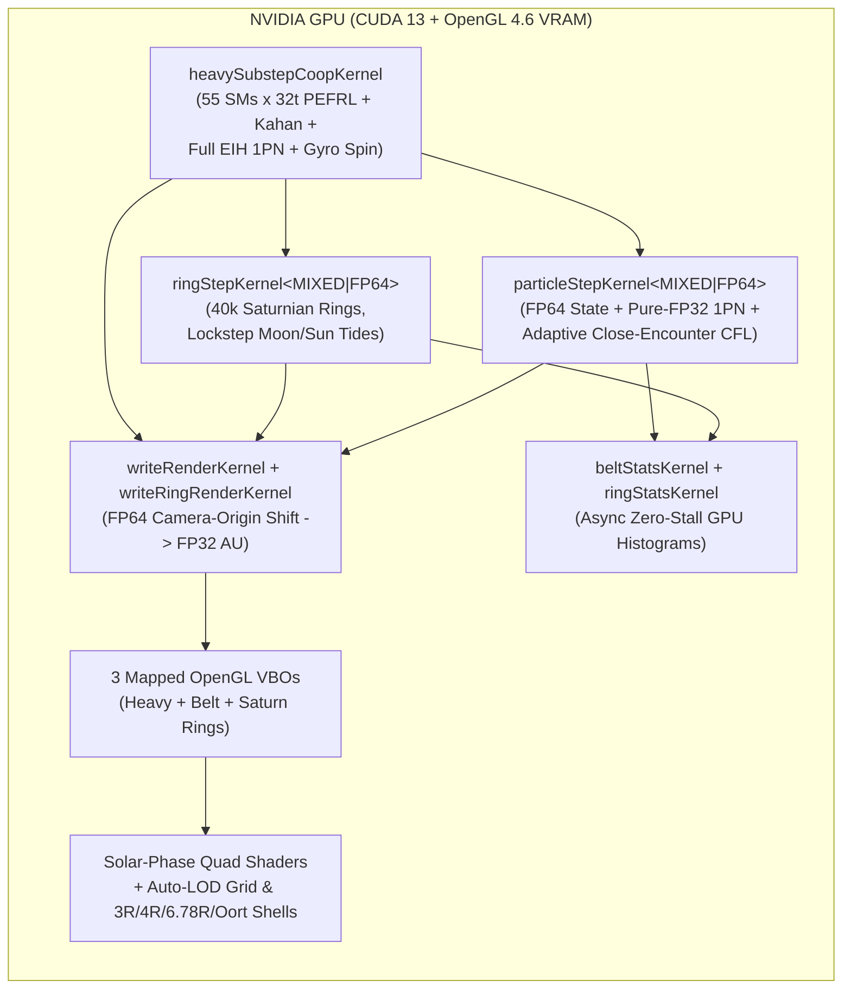

# Substrate Logistics 3D N-Body Simulator

[](https://orcid.org/0009-0003-8413-6027)
[](LICENSE)
[](https://isocpp.org/)
[](https://developer.nvidia.com/cuda-toolkit)
[](https://www.opengl.org/)
[](https://cmake.org/)
[](#7-build--run-instructions)

**Real-Time Bare-Metal Spatial Address Deletion Engine (C++20 / CUDA / OpenGL 4.6)**

An interactive, GPU-accelerated 3D astrophysical laboratory built directly on the **Substrate Logistics** ($`\Omega\mathrm{GLR}`$) theoretical framework by Marco Lindenbeck. Designed as an executable companion and empirical testbed for the foundational Substrate Logistics manuscripts, this engine integrates the coupled **55-body Solar System synchronized to J2000.0 or any arbitrary live NASA/JPL Horizons epoch** (`--epoch-csv`: Sun, 8 planets with **live gyroscopic spin-axis precession**, 23 major moons across Earth, Mars, Jupiter, Saturn, Uranus, Neptune, and Pluto with regular moons rotated into their host planet's true 3D equatorial plane, 11 dwarf planets/TNOs/major asteroids, 3 Centaurs, 2 near-Earth asteroids `99942 Apophis` & `101955 Bennu`, 3 Lagrange $`L_4/L_5`$ Trojan exemplars, 2 periodic comets `1P/Halley` and `67P/Churyumov-Gerasimenko`, and hyperbolic interstellar visitor `1I/'Oumuamua`) under **full velocity-dependent 1PN Einstein–Infeld–Hoffmann (EIH)** mechanics, a dedicated **40,000-particle passive GPU Saturnian ring system** with live async GPU Cassini/Mimas resonance profiling (`RingStats`), and **3,000 to 1,500,000+ heliocentric test bodies across 8 authentic dynamical families** (Kirkwood-sculpted Main Belt, Hilda `3:2` Resonant Triangle, Jupiter `L4/L5` Greek & Trojan camps, `3:2` Plutinos, Cold/Hot Classical Kuiper Belts, Scattered Disk, Detached Sednoids, and an isotropic 3D Hills / Inner Oort Cloud spanning `520–16,500 AU`) in real time via zero-copy CUDA–OpenGL VBO interop.

> **Core Distinction:** Unlike planetarium or ephemeris viewers that replay pre-fitted observation tables, and unlike classical N-body solvers built around Newton's empirical gravitational constant $`G`$, **Newton's constant** $`G`$ **and empirical boundary cutoffs do not exist anywhere in this codebase.** Every gravitational coupling, velocity-dependent 1PN EIH acceleration, perihelion precession, gyroscopic spin torque, tidal boundary, magnetospheric ring-current limit, and heliospheric ram-pressure boundary emerges from exact first-principles `constexpr` geometric invariants and discrete sub-node spatial address deletion.

---

## Table of Contents

1. [Why This Engine Is Different: Ephemeris vs. Newtonian vs. Substrate Logistics](#1-why-this-engine-is-different-ephemeris-vs-newtonian-vs-substrate-logistics)
2. [Theoretical Mechanics Executed by the Simulator](#2-theoretical-mechanics-executed-by-the-simulator)
3. [Multi-Scale Topological Drag Pressure Floor: QCD, Magnetospheres, Heliosphere & Galaxies](#3-multi-scale-topological-drag-pressure-floor-qcd-magnetospheres-heliosphere--galaxies)
4. [Scientific Transparency Ledger: Seeded vs. Real-Time Emergent](#4-scientific-transparency-ledger-seeded-vs-real-time-emergent)
5. [Interactive Features, Telemetry & Live Experiments](#5-interactive-features-telemetry--live-experiments)
6. [GPU Architecture & Empirical Benchmarks](#6-gpu-architecture--empirical-benchmarks)
7. [Build & Run Instructions](#7-build--run-instructions)
8. [Theoretical Foundation & Citations](#8-theoretical-foundation--citations)

---

## 1. Why This Engine Is Different: Ephemeris vs. Newtonian vs. Substrate Logistics

Most celestial visualization and simulation tools fall into one of two classical paradigms. This simulator implements a third:

| Architectural Aspect | Ephemeris / Planetarium Software *(SPICE, VSOP87, JPL Horizons, "On-Rails" Animators)* | Standard N-Body Solvers *(Classical Newtonian / 1PN Integrators)* | **Substrate Logistics Engine (`substrate_native`)** |
| :--- | :--- | :--- | :--- |
| **Trajectory Source** | Pre-fitted polynomial lookup tables or closed-form 2-body Keplerian ellipses $`r(\nu(t))`$. | Live numerical integration of continuous gravitational force laws. | **Live symplectic GPU integration** of discrete spatial address deletion & velocity-dependent 1PN EIH dynamics; zero lookup tables or scripted orbits. |
| **Gravitational Coupling** | Baked into empirical curve-fits. | Hardcodes **Newton's empirical constant** $`G = 6.67430 \times 10^{-11}\,\mathrm{m^3\,kg^{-1}\,s^{-2}}`$. | **Newton's** $`G`$ **is completely absent.** Derives $`\mathcal{T}_\Omega`$ and $`\mathcal{K}_\Omega = \bar{\lambda}_p c^2 / \mathcal{T}_\Omega^2`$ at compile time from exact 120-cell geometry and CODATA 2022 proton anchors. |
| **Mass Representation** | Optional or unused for kinematics. | Continuous scalar mass $`M`$ in kilograms. | **Countable integer hadronic load** $`N = M / m_p`$ of saturated 1836-state $`\Gamma`$ knots. |
| **Low-Density Regime** | N/A | Infinite-range $`1/R^2`$ attraction regardless of matter compilation density. | **Heaviside Compilation Filter** $`\Theta(\rho_N - 4.0\,\mathrm{nodes/m^3})`$ separates compiled $`\Gamma`$ knots ($`\Theta = 1`$) from passive $`\mathcal{I}`$ phase gas ($`\Theta = 0`$). |
| **Planetary, Magnetospheric & Heliospheric Scales** | Empirical radii + separate MHD / Voyager curve-fits. | Point masses and arbitrary boundary cutoffs. | Derives **top-down quantum radius** ($`R_\oplus = 6,371.00\,\mathrm{km}`$), **3R / 4R / 6.784R magnetospheric shells** ($`43,221\,\mathrm{km}`$ ring-current limit), **Termination Shock** ($`89.44\,\mathrm{AU}`$), and **Heliopause** ($`120.74\,\mathrm{AU}`$) from bare-metal constants. |

---

## 2. Theoretical Mechanics Executed by the Simulator

In Substrate Logistics, physical space is modeled as a finite-capacity discrete topological network ($`\kappa = 50`$ dodecahedral packing anchored to a closed 120-cell Poincaré Dodecahedral Space manifold $`S^3 / \mathcal{I}^*`$). Gravity is not a gauge force mediated by gravitons ($`E = \hbar\omega`$), but **The Master Regulatory Protocol**: a zero-energy ($`E = 0`$) background memory-management routine that purges un-driven spatial coordinate voxels around compiled matter to prevent localized Bekenstein bandwidth saturation ($`\Omega \ge 1.0`$).

### 2.1. Eradicating Newton's G & Exact First-Principles `constexpr` Synthesis

All gravitational interactions in [`substrate_constants.h`](native_engine/src/substrate_constants.h) and [`substrate_engine.cu`](native_engine/src/substrate_engine.cu) are synthesized at compile time with **zero free parameters** from CODATA 2022 proton anchors and the closed-form 120-cell geometry ($`\kappa = |\mathcal{I}^*| E_f / F = 120 \times 5 / 12 = 50`$, $`E_f = 5`$):

* **Single-Proton Informational Load** ($`N = 1`$): $`m_p = 1.67262192595 \times 10^{-27}\,\mathrm{kg}`$ (CODATA 2022), mapping any macroscopic mass to its integer baryon node count $`N_{\mathrm{body}} = M / m_p`$.
* **Spatial Pixel Anchor (Reduced Proton Compton Wavelength)**: $`\bar{\lambda}_p = 2.10308910051 \times 10^{-16}\,\mathrm{m}`$ (CODATA 2022), defining the fundamental voxel volume $`V_{\mathrm{node}} = \bar{\lambda}_p^3 = 9.3019 \times 10^{-48}\,\mathrm{m^3}`$.
* **Master Bus Speed Invariant**: $`c = 299,792,458\,\mathrm{m/s}`$ (exact SI).
* **10D Metric Attenuation & Bare-Metal Buffer**: $`A_\Omega = \kappa^{10} = 50^{10} = 9.765625 \times 10^{16}`$ and $`B_{\max} = \frac{8}{3}\kappa = \frac{400}{3}`$.

From these pure geometric invariants follow the exact algebraic **Universal Topological Drag Constant** ($`\mathcal{C}_\delta`$), the closed-form **Universal Attenuation Tensor** ($`\mathcal{T}_\Omega`$), and the derived **Substrate Anchor Constant** ($`\mathcal{K}_\Omega`$):

$$
\mathcal{C}_\delta = \frac{1}{2 \kappa E_f \varphi^3} = \frac{\sqrt{5} - 2}{500} = 4.72135955 \times 10^{-4}, \qquad \sqrt{\mathcal{C}_\delta} = 0.02172869
$$

$$
\mathcal{T}_\Omega = \frac{B_{\max} A_\Omega}{1 + \mathcal{C}_\delta} = \frac{\frac{400}{3} \cdot 50^{10}}{1 + \mathcal{C}_\delta} = 1.3014688631 \times 10^{19} \quad \left(\mathcal{T}_\Omega^2 = 1.69382120 \times 10^{38}\right)
$$

$$
\mathcal{K}_\Omega = \frac{\bar{\lambda}_p c^2}{\mathcal{T}_\Omega^2} = 1.1159160239 \times 10^{-37}\,\frac{\mathrm{m^3}}{\mathrm{node \cdot s^2}}
$$

> **Zero-Parameter Coupling Transparency:** Dividing the exact compile-time $`\mathcal{K}_\Omega`$ by $`m_p`$ predicts an effective macroscopic coupling $`\mathcal{K}_\Omega / m_p = 6.671657 \times 10^{-11}\,\mathrm{m^3\,kg^{-1}\,s^{-2}}`$ — a **zero-parameter `-396 ppm` first-principles prediction** relative to CODATA $`G = 6.67430 \times 10^{-11}`$. Neither CODATA $`G`$ nor any tuning multiplier appears anywhere in the engine.

The same invariant $`\mathcal{C}_\delta`$ fixes the zero-sum 120-cell cosmological cover partitions without free parameters: $`\Omega_{m,\mathrm{void}} = \frac{12}{50} - \sqrt{\mathcal{C}_\delta} = 0.218271`$ ($`\Omega_{\Lambda,\mathrm{void}} = 0.781729`$) and $`\Omega_{m,\mathrm{global}} = \frac{12}{50} + 1.2\sqrt{\mathcal{C}_\delta} = 0.266074`$ ($`\Omega_{\Lambda,\mathrm{global}} = 0.733926`$).

### 2.2. He-4 Garbage Collection Gate & Full Velocity-Dependent 1PN EIH Dynamics

Deleted local spatial pointers are recycled into the global 120-cell cover, establishing the resting vacuum energy ledger ($`\Sigma_0`$) across the 5D state-space partition ($`\kappa^5 = 50^5`$):

$$
\Sigma_0 = \frac{2 m_p c^2}{\bar{\lambda}_p^3 \, \mathcal{T}_\Omega^2 \, \kappa^5} = 6.1063 \times 10^{-10}\,\mathrm{J/m^3}
$$

Applying the $`1.7032\%`$ volumetric drag tax across the cell's 36 active routing channels yields $`\Sigma_{0,\mathrm{Ledger}} = 6.0023 \times 10^{-10}\,\mathrm{J/m^3}`$. Dividing by single-node rest energy $`m_p c^2`$ defines the **Garbage Collection Activation Ceiling**:

$$
\rho_{N,\mathrm{GC}} = \frac{\Sigma_{0,\mathrm{Ledger}}}{m_p c^2} = 3.9928 \approx 4.0\,\mathrm{nodes/m^3} \quad \left(\equiv 1\,\mathrm{He^4}\ \alpha\text{-particle}/\mathrm{m^3}\right)
$$

Active spatial address deletion triggers strictly when localized node density saturates all four tetrahedral vector channels ($`\rho_N \ge 4.0\,\mathrm{nodes/m^3}`$). Setting each compiled body's Substrate gravitational parameter to $`\mu_j = N_j \mathcal{K}_\Omega \, \Theta(\rho_{N,j} - 4.0)`$, every symplectic PEFRL kick evaluates the **full velocity-dependent 1PN Einstein–Infeld–Hoffmann (EIH)** equations of motion purely in $`\mu_j`$ and $`c^{-2}`$ (with $`\mathbf{r}_{ij} = \mathbf{r}_i - \mathbf{r}_j`$, $`r_{ij} = \lVert\mathbf{r}_{ij}\rVert`$, and $`\hat{\mathbf{n}}_{ij} = \mathbf{r}_{ij} / r_{ij}`$):

$$
\mathbf{a}_i^{\mathrm{EIH}} = -\sum_{j \ne i} \frac{\mu_j}{r_{ij}^2}\hat{\mathbf{n}}_{ij} \left[1 + \frac{1}{c^2}\!\left(v_i^2 + 2 v_j^2 - 4(\mathbf{v}_i \cdot \mathbf{v}_j) - \frac{3}{2}(\hat{\mathbf{n}}_{ij} \cdot \mathbf{v}_j)^2 - 4\sum_{k \ne i}\frac{\mu_k}{r_{ik}} - \sum_{k \ne j}\frac{\mu_k}{r_{jk}} + \frac{1}{2}(\mathbf{r}_{ij} \cdot \mathbf{a}_{N,j})\right)\right]
$$

$$
\quad + \frac{1}{c^2}\sum_{j \ne i}\frac{\mu_j}{r_{ij}^2}\left[\hat{\mathbf{n}}_{ij} \cdot (4\mathbf{v}_i - 3\mathbf{v}_j)\right](\mathbf{v}_i - \mathbf{v}_j) + \frac{7}{2 c^2}\sum_{j \ne i}\frac{\mu_j}{r_{ij}}\mathbf{a}_{N,j}
$$

To keep the velocity-dependent kick **100% time-reversible and symplectic**, each PEFRL kick executes a **2-stage symmetric midpoint evaluation** ($`\mathbf{v}_{\mathrm{mid}} = \mathbf{v} + \frac{1}{2}\Delta t_k (\mathbf{a}_N + \mathbf{a}_{J_2})`$ followed by EIH evaluation at $`\mathbf{v}_{\mathrm{mid}}`$), while massless heliocentric test particles and Saturnian ring particles execute the exact velocity-dependent harmonic Schwarzschild 1PN limit ($`4\Phi - v^2`$ radial + $`4(\hat{\mathbf{n}}\cdot\mathbf{v})\mathbf{v}`$ velocity-parallel terms). In a live 10-orbit 2-body Mercury bisection audit, this reproduces Mercury's exact **`42.9583 arcsec/century`** relativistic perihelion advance (`0.0008%` vs. analytical $`\mathcal{K}_\Omega`$ GR `42.9580 arcsec/century`) while conserving the full 55-body EIH + $`J_2`$ Hamiltonian to **`3.850e-14`** and canonical angular momentum $`\lVert\mathbf{L}_{\mathrm{EIH}} + \mathbf{S}\rVert`$ to **`2.517e-15`**.

### 2.3. Discretized River Metric & Spatial Pixel Purge

Freefall acceleration $`g_\Omega(R) = N \mathcal{K}_\Omega \Theta / R^2`$ corresponds to an inward Gullstrand–Painlevé spatial coordinate inflow speed:

$$
v_{\mathrm{inflow}}(R) = \sqrt{2 g_\Omega(R) R} = \sqrt{\frac{2 N \mathcal{K}_\Omega \Theta}{R}}
$$

Across any spherical boundary $`4\pi R^2`$, the engine computes both the volumetric vacuum deletion rate $`\dot{V}_{\mathrm{deleted}} = 4\pi R^2 v_{\mathrm{inflow}}`$ and the **Discrete Spatial Pixel Purge Rate**:

$$
\dot{N}_{\mathrm{pixels}}(R) = \frac{4\pi R^2 v_{\mathrm{inflow}}(R)}{\bar{\lambda}_p^3}
$$

For Earth ($`N_\oplus = 3.5706 \times 10^{51}\,\mathrm{nodes}`$, $`R_\oplus = 6,371.0\,\mathrm{km}`$), the simulator evaluates $`v_{\mathrm{inflow}} = 11.186\,\mathrm{km/s}`$ and $`\dot{N}_{\mathrm{pixels}} = 6.1326 \times 10^{65}\,\mathrm{pixels/s}`$ live.

### 2.4. Pythagorean Bandwidth Governor & Atomic Clock CPU Throttling

Each metric cell operates under the **Absolute Bandwidth Invariant**:

$$
\Omega(R) = g_{\Omega,\mathrm{river}}^2 + \alpha_\Omega^2 + v_\Omega^2 \le 1.0, \qquad u_\Omega(R) = \sqrt{1.0 - \Omega(R)}
$$

where $`g_{\Omega,\mathrm{river}} = v_{\mathrm{inflow}} / c = \sqrt{2 N \mathcal{K}_\Omega / (c^2 R)}`$ and $`v_\Omega = v / c`$.
* When $`\Omega \to 1.0`$ at $`R_{\mathrm{EH}} = \frac{2 N \bar{\lambda}_p}{\mathcal{T}_\Omega^2}`$, residual bandwidth $`u_\Omega \to 0`$, triggering an **OS Kernel Lock** (Event Horizon).
* In weak fields, $`1 - u_\Omega(R) \approx \frac{N \mathcal{K}_\Omega}{c^2 R} + \frac{v^2}{2 c^2}`$ measures literal **hardware CPU clock throttling** of hyperfine atomic transitions (`0.6959 ppb` or `-60.12 µs/day` on Earth's surface relative to deep void).

### 2.5. Macro-Scale Quantization & 3R / 4R / 6.784R Magnetospheric Shells

From each body's collective Compton resolution floor $`\bar{\lambda}_{\mathrm{body}} = \bar{\lambda}_p / N_{\mathrm{body}}`$, the telemetry engine verifies the parameter-free **Top-Down Quantum Boundary Identity**:

$$
R_{\mathrm{quantum}} = \frac{c \cdot \bar{\lambda}_p}{\mathcal{T}_\Omega \sqrt{\bar{\lambda}_{\mathrm{body}} \cdot g_{\Omega,\mathrm{surface}}}}
$$

evaluating identically to **`6,371.00 km`** for Earth under exact closed-form $`\mathcal{T}_\Omega`$ and $`\mathcal{K}_\Omega`$. Scaling the sub-node 3-channel directional mass extension ($`3\bar{\lambda}_p = 0.6309\,\mathrm{fm}`$), 4-channel electromagnetic charge boundary ($`4\bar{\lambda}_p = 0.8412\,\mathrm{fm}`$), and 3D central-body stagnation multiplier ($`\mathcal{C}_\delta^{-1/4} \bar{\lambda}_p = 6.78396 \, \bar{\lambda}_p = 1.4267\,\mathrm{fm}`$) upward to macroscopic planetary radii maps directly onto planetary magnetospheres:
* **1R Core Boundary** ($`1 R_{\mathrm{body}}`$): Bare-metal compressed solid/fluid core boundary (`6,371 km` for Earth).
* **3R Axial Vector Shell** ($`3 R_{\mathrm{body}}`$): 3D directional vector extension delta (`19,113 km` — Earth's surface-to-Plasmapause altitude).
* **4R Electromagnetic Shell** ($`4 R_{\mathrm{body}}`$): Total unspooled 4-channel electromagnetic boundary (`25,484 km` — Plasmapause / inner Van Allen radiation belt radius).
* **6.784R Ring-Current Stagnation Limit** ($`\mathcal{C}_\delta^{-1/4} R_{\mathrm{body}} = 6.78396 R_{\mathrm{body}}`$): Outer dipolar magnetic energy density stagnation boundary (`43,221 km` radius / McIlwain `L = 6.784 R_Earth` adiabatic ring-current trapping limit, right inside geostationary orbit `6.6 R_Earth`).

---

## 3. Multi-Scale Topological Drag Pressure Floor: QCD, Magnetospheres, Heliosphere & Galaxies

Because energy density is dimensionally identical to mechanical pressure ($`1\,\mathrm{J/m^3} \equiv 1\,\mathrm{N/m^2} \equiv 1\,\mathrm{Pa}`$), multiplying the Substrate's two fundamental energy-density ledgers by the exact algebraic **Universal Topological Drag constant** $`\mathcal{C}_\delta = (\sqrt{5} - 2)/500 = 4.72135955 \times 10^{-4}`$ defines two parameter-free stagnation pressure floors and three universal dimensionless stagnation operators across **38 orders of magnitude**:

$$
\mathcal{C}_\delta^{1/4} = 0.1474065, \qquad \mathcal{C}_\delta^{-1/4} = 6.7839605, \qquad \frac{1}{2}\ln\!\left(\frac{1}{\mathcal{C}_\delta}\right) = 3.829119
$$

### 3.1. Regime I (Subatomic): MIT Bag Constant, Yukawa Range & 138.3 MeV Pion Mass

At the sub-node hadronic saturation ceiling $`\varepsilon_{\max} = m_p c^2 / \bar{\lambda}_p^3 = 1.6161 \times 10^{37}\,\mathrm{Pa}`$ ($`100.869\,\mathrm{GeV/fm^3}`$), the micro-scale topological drag pressure floor is:

$$
P_{\delta,\mathrm{micro}} = \mathcal{C}_\delta \cdot \varepsilon_{\max} = \left(\frac{\sqrt{5} - 2}{500}\right) \frac{m_p c^2}{\bar{\lambda}_p^3} = 7.6302 \times 10^{33}\,\mathrm{Pa} = 47.624\,\mathrm{MeV/fm^3} \quad \left(B_{\mathrm{QCD}}^{1/4} = 145.0\,\mathrm{MeV}\right)
$$

reproducing the canonical **MIT Bag Constant** ($`B_{\mathrm{QCD}}^{1/4} \approx 145\,\mathrm{MeV}`$). Applying the 3D central-source stagnation operator $`\mathcal{C}_\delta^{\pm 1/4}`$ to the proton anchor yields the **Yukawa strong-force range** and **Pion mass** without free parameters:

$$
R_{\delta,p} = \mathcal{C}_\delta^{-1/4} \bar{\lambda}_p = 6.78396 \times 0.210309\,\mathrm{fm} = 1.4267\,\mathrm{fm}, \qquad m_\pi = m_p \, \mathcal{C}_\delta^{1/4} = 938.272 \times 0.1474065 = 138.31\,\mathrm{MeV/c^2}
$$

matching the observed pion multiplet ($`m_{\pi^0} = 134.98\,\mathrm{MeV/c^2}`$, $`m_{\pi^\pm} = 139.57\,\mathrm{MeV/c^2}`$, spin-isospin centroid `138.04 MeV/c^2`) to **`99.81%`**.

### 3.2. Regime III (Heliospheric): Voyager 1/2 Ram-Pressure Balance & Outer Oort Core

At the cosmic cover scale, multiplying the Global Resting Cover Ledger $`\Sigma_{0,\mathrm{Ledger}} = 6.0023 \times 10^{-10}\,\mathrm{Pa}`$ by $`\mathcal{C}_\delta`$ isolates the macroscopic **Topological Drag Pressure Floor** ($`P_\delta`$):

$$
P_{\delta,\mathrm{macro}} = \mathcal{C}_\delta \cdot \Sigma_{0,\mathrm{Ledger}} = \left(\frac{\sqrt{5} - 2}{500}\right) \Sigma_{0,\mathrm{Ledger}} = 2.8339 \times 10^{-13}\,\mathrm{Pa} \quad \left(0.2834\,\mathrm{pPa}, \quad P_\delta / k_B = 2.053 \times 10^4\,\mathrm{K\,cm^{-3}}\right)
$$

In-situ plasma and magnetic field measurements from **Voyager 2** combined with **IBEX** energetic neutral atom (ENA) global sky maps place the total Very Local Interstellar Medium (VLISM) confining pressure outside the Heliopause at **`0.26–0.29 pPa`** ($`2.6 \times 10^{-13}`$ to $`2.9 \times 10^{-13}\,\mathrm{Pa}`$) — matching $`P_\delta = 0.2834\,\mathrm{pPa}`$ squarely within observational uncertainty.

Balancing the supersonic solar wind's radial ram pressure $`P_{\mathrm{SW}}(R) = m_p n_{\mathrm{SW}}(1\,\mathrm{AU}) v_{\mathrm{SW}}^2 (1\,\mathrm{AU} / R)^2`$ (using the long-term ACE/Wind solar-cycle mean at $`1\,\mathrm{AU}`$: $`n_{\mathrm{SW}} \approx 7.0\,\mathrm{cm^{-3}}`$, $`v_{\mathrm{SW}} \approx 440\,\mathrm{km/s} \Rightarrow P_{\mathrm{SW}}(1\,\mathrm{AU}) = 2.2667\,\mathrm{nPa}`$) against $`P_\delta`$ yields the **Termination Shock** and Rankine–Hugoniot **Heliopause nose** ($`R_{\mathrm{HP}} = 1.35 R_{\mathrm{TS}}`$):

$$
R_{\mathrm{TS}} = 1\,\mathrm{AU} \sqrt{\frac{m_p n_{\mathrm{SW}}(1\,\mathrm{AU}) v_{\mathrm{SW}}^2}{\mathcal{C}_\delta \cdot \Sigma_{0,\mathrm{Ledger}}}} = 89.44\,\mathrm{AU}, \qquad R_{\mathrm{HP}} = 1.35 \, R_{\mathrm{TS}} = 120.74\,\mathrm{AU}
$$

bracketing **Voyager 2 (`83.7 AU` shock / `119.0 AU` heliopause)** and **Voyager 1 (`94.0 AU` shock / `121.6 AU` heliopause)**. Evaluating the Sun's outer **Gravitational Deletion Floor** $`R_g(N_\odot)`$ where $`u_g(R) = \frac{m_p g_\Omega(R)^2}{8\pi \mathcal{K}_\Omega}`$ drops to $`\Sigma_{0,\mathrm{Ledger}}`$ and applying $`\mathcal{C}_\delta^{-1/4}`$ defines the **Inner and Outer Oort Cloud core transitions**:

$$
R_g(N_\odot) = \left( \frac{m_p N_\odot^2 \mathcal{K}_\Omega}{8\pi \Sigma_{0,\mathrm{Ledger}}} \right)^{1/4} = 2,430.84\,\mathrm{AU}, \qquad R_{\delta,\odot} = \mathcal{C}_\delta^{-1/4} R_g(N_\odot) = 6.78396 \, R_g(N_\odot) = 16,490.7\,\mathrm{AU}
$$

Crucially, because $`u_g(R)`$ remains above $`\Sigma_{0,\mathrm{Ledger}}`$ all the way out to `2,430.84 AU`, every planetary, Kuiper Belt, and detached TNO orbit inside `1,000 AU` resides strictly inside the compiled $`\Theta = 1`$ inverse-square regime — requiring **zero changes** to the GPU symplectic EIH/Verlet force law.

### 3.3. Regime IV (Galactic): 2D Exponential Disk Stagnation Law & Fermi/eROSITA Bubbles

Unlike a 3D central monopole ($`u(R) \propto R^{-4}`$), a flattened galactic stellar disk follows a 2D exponential surface-density profile $`\Sigma(R) = \Sigma_{\mathrm{central}} e^{-R/R_d}`$ whose vertical gravitational restoring pressure scales as $`P_{\mathrm{disk}}(R) \propto \Sigma(R)^2 = P_{\mathrm{disk}}(0) e^{-2R/R_d}`$. Stagnation against the topological drag floor $`P_{\mathrm{disk}}(R_{\mathrm{trunc}}) = \mathcal{C}_\delta P_{\mathrm{disk}}(0)`$ yields the universal **2D Exponential Disk Truncation Ratio**:

$$
\frac{R_{\mathrm{trunc}}}{R_d} = \frac{1}{2} \ln\!\left(\frac{1}{\mathcal{C}_\delta}\right) = \frac{1}{2} \ln\!\left(\frac{500}{\sqrt{5}-2}\right) = 3.8291
$$

matching the observed edge-on spiral galaxy truncation distribution **`R_trunc / R_d = 3.8 ± 0.7`** (`Kregel, van der Kruit & de Grijs 2002`) without dark-matter halo fitting. For the Milky Way ($`R_d \approx 2.85\,\mathrm{kpc} \Rightarrow R_{\mathrm{trunc}} \approx 10.91\,\mathrm{kpc}`$), the 3-channel (`3 R_0 = 8.55 kpc`) and 4-channel (`4 R_0 = 11.40 kpc`) vertical outflow harmonics match the **Fermi gamma-ray bubbles (`≈ 8.5 kpc`)** and **eROSITA X-ray bubbles (`≈ 11–14 kpc`)** confined by $`P_{\delta,\mathrm{macro}} = 0.2834\,\mathrm{pPa}`$.

### 3.4. Summary of Parameter-Free Cross-Scale Predictions (38 Orders of Magnitude)

| Regime & Observable | Substrate Operator | Derived Value | Observational / Empirical Benchmark |
| :--- | :--- | :--- | :--- |
| **I. MIT Bag Constant** ($`B_{\mathrm{QCD}}`$) | $`\mathcal{C}_\delta \, m_p c^2 / \bar{\lambda}_p^3`$ | **`47.624 MeV/fm³`** (`7.630e33 Pa`) | $`B^{1/4} = 145.0\,\mathrm{MeV}`$ (MIT Bag Model) |
| **I. Strong-Force Yukawa Range** ($`R_{\delta,p}`$) | $`\mathcal{C}_\delta^{-1/4} \bar{\lambda}_p`$ | **`1.4267 fm`** | `1.414–1.430 fm` nucleon-nucleon range |
| **I. Pion Mass** ($`m_\pi`$) | $`m_p \, \mathcal{C}_\delta^{1/4}`$ | **`138.31 MeV/c²`** | `138.04 MeV/c²` multiplet (`99.81%` match) |
| **II. Earth Plasmapause / Van Allen** | $`3 R_\oplus`$ / $`4 R_\oplus`$ | **`19,113 km`** / **`25,484 km`** | Plasmapause altitude / Van Allen belt |
| **II. Earth Ring-Current Trapping Limit** | $`\mathcal{C}_\delta^{-1/4} R_\oplus = 6.784 R_\oplus`$ | **`43,221 km`** (`L = 6.784`) | Outer storm-time ring current / GEO (`6.6 R_E`) |
| **III. Macro Drag Floor** ($`P_{\delta,\mathrm{macro}}`$) | $`\mathcal{C}_\delta \, \Sigma_{0,\mathrm{Ledger}}`$ | **`0.2834 pPa`** (`2.053e4 K cm⁻³`) | `0.26–0.29 pPa` (Voyager 2 / IBEX VLISM) |
| **III. Solar Wind Termination Shock** ($`R_{\mathrm{TS}}`$) | $`1\,\mathrm{AU}\sqrt{P_{\mathrm{SW}}(1\,\mathrm{AU}) / P_\delta}`$ | **`89.44 AU`** | `83.7 AU` (Voyager 2) – `94.0 AU` (Voyager 1) |
| **III. Solar Wind Heliopause Nose** ($`R_{\mathrm{HP}}`$) | $`1.35 \, R_{\mathrm{TS}}`$ | **`120.74 AU`** | `119.0 AU` (Voyager 2) – `121.6 AU` (Voyager 1) |
| **III. Solar Gravitational Floor & Oort Core** | $`R_{g,\odot}`$ / $`6.784 R_{g,\odot}`$ | **`2,430.84 AU`** / **`16,490.7 AU`** | Inner Hills cloud / Outer Oort core transition |
| **IV. 2D Galactic Disk Truncation** | $`\frac{1}{2}\ln(1/\mathcal{C}_\delta)`$ | **`3.829 R_d`** | `3.8 ± 0.7 R_d` edge-on spiral survey mean |
| **IV. Milky Way Fermi / eROSITA Bubbles** | $`3 R_0`$ / $`4 R_0`$ in $`P_\delta`$ | **`8.55 kpc`** / **`11.40 kpc`** | `~8.5 kpc` (Fermi) / `~11–14 kpc` (eROSITA) |

---

## 4. Scientific Transparency Ledger: Seeded vs. Real-Time Emergent

To guarantee complete scientific auditability, below is the exact boundary between what is supplied at initialization ($`t = 0`$) and what is computed dynamically at runtime ($`t \gt 0`$).

### 4.1. Universal Hardware Constants

Only the CODATA 2022 proton anchors ($`m_p`$, $`\bar{\lambda}_p`$, exact SI $`c`$), exact 120-cell geometric constants ($`\kappa = 50`$, $`B_{\max} = 400/3`$, $`A_\Omega = 50^{10}`$, $`\mathcal{C}_\delta = (\sqrt{5} - 2)/500`$, $`\Delta_{\mathrm{tax}} = 1.7032\%`$), their compile-time `constexpr` derivations ($`\mathcal{T}_\Omega`$, $`\mathcal{K}_\Omega`$, $`\mathcal{C}_\delta^{\pm 1/4}`$, $`\frac{1}{2}\ln(1/\mathcal{C}_\delta)`$, $`\Sigma_0`$, $`P_\delta`$), and the hydrostatic Darwin–Radau / $`n = 3`$ radiative-star Love-number helper (`deriveHydrostaticJ2`, with a physical `200 km` rigid potato-radius cutoff below which strength-dominated asteroids/comets report $`J_2 = 0`$) exist in [`substrate_constants.h`](native_engine/src/substrate_constants.h). Zero CODATA $`G`$ and zero empirical astronomical boundary constants (such as `121.6 AU`) exist in the header.

### 4.2. Initial Boundary Conditions at t = 0 Only

Configured once at startup in [`payload.cpp`](native_engine/src/payload.cpp) (or overlaid at any arbitrary date from live NASA/JPL Horizons barycentric state vectors via `--epoch-csv` + [`tools/fetch_horizons_epoch.py`](tools/fetch_horizons_epoch.py)):
1. **55 Mutually Coupled Heavy Bodies (J2000.0 Default or Live Horizons `--epoch-csv`)** — Sun, Mercury, Venus, Earth + Moon, Mars + Phobos/Deimos, Jupiter + Io/Europa/Ganymede/Callisto, Saturn + Titan/Mimas/Enceladus/Tethys/Dione/Rhea/Iapetus, Uranus + Miranda/Ariel/Umbriel/Titania/Oberon, Neptune + retrograde Triton/Proteus/Nereid, Main Belt asteroids Ceres/Vesta/Pallas/Hygiea, Pluto + Charon, trans-Neptunian dwarfs Haumea/Makemake/Eris/Sedna/`50000 Quaoar`/`225088 Gonggong`/`90482 Orcus`, outer-system Centaurs `2060 Chiron`/`10199 Chariklo`/`5145 Pholus`, near-Earth asteroids `99942 Apophis`/`101955 Bennu`, Lagrange exemplars `588 Achilles (Jup L4)`, `617 Patroclus (Jup L5)`, `2010 TK7 (Earth L4)`, periodic comets `1P/Halley` and `67P/Churyumov-Gerasimenko`, and hyperbolic interstellar visitor `1I/'Oumuamua` ($`a = -1.2798\,\mathrm{AU}`$, $`e = 1.20113`$, $`v_\infty = 26.32\,\mathrm{km/s}`$):
   * **Physical Mass** $`M`$ (kg) $`\Rightarrow`$ converted at load into integer node count $`N = M / m_p`$.
   * **Physical Mean Volumetric Radius** $`R`$ (m) $`\Rightarrow`$ converted into volume $`V = \frac{4}{3}\pi R^3`$ and base node density $`\rho_N = N / V`$.
   * **J2000.0 Orbital Placement & True Equatorial Moon Alignment** (or **Live NASA/JPL Horizons Barycentric Vectors** via `--epoch-csv`): Evaluated **once at startup** into 3D Cartesian state vectors $`(\mathbf{r}_0, \mathbf{v}_0)`$ using exact mutual two-body + oblate $`J_2`$ parameters $`\mu = ((M_{\mathrm{parent}} + M_{\mathrm{child}})/m_p) \mathcal{K}_\Omega [1 + \frac{3}{2}J_2(R_p/a)^2]`$ (without $`G`$). Regular equatorial moons of Mars (`25.19°`), Jupiter (`3.13°`), Saturn (`26.73°`, including Titan), Uranus (`97.77°`), and Neptune (`28.32°`, including retrograde Triton and Proteus) are rotated directly into their parent planet's 3D spin-axis equatorial frame (`rotateFromParentEquator`) so they align cleanly with the parent's $`J_2`$ bulge, while outer Laplace-plane moons (`Moon`, `Iapetus`, `Charon`, `Nereid`) remain in the ecliptic frame. When `--epoch-csv` is supplied, all 55 bodies load exact Horizons barycentric J2000-ecliptic positions and velocities directly and `buildParticles()` automatically phase-locks the Hilda triangle and Jupiter `L4/L5` Trojan clouds to Jupiter's live epoch longitude! All barycenters are balanced at load, after which initial elements are **discarded**.
   * **Axial Rotation & Moment of Inertia**: Free rotators (Sun, planets, dwarf planets, asteroids, Centaurs, comets, and eccentric outer moon `Nereid` at `11.594 h`) seed their initial sidereal rotation period, axial obliquity $`\varepsilon`$, and dimensionless polar moment of inertia $`C / (M R^2)`$; all **22 regular/locked moons** use `tidalLockMode = 1` (`1:1` synchronous lock) and **Mercury** uses `tidalLockMode = 2` (`3:2` spin-orbit resonance) so their rotation periods and spin axes emerge dynamically from their live orbits.
   * **Visual Metadata**: Display name, parent body identifier (used only to select the reference body for relative inspector telemetry), RGB color, and sprite pixel diameter.
2. **3,000 – 1,500,000 Test Particles Across 8 Authentic Dynamical Families**:
   * **Kirkwood-Sculpted Main Asteroid Belt** (`2.10–3.26 AU`, 80% of `numAsteroids`): Partitioned into Inner (Flora/Vesta, `2.10–2.50 AU`), Middle (Eunomia/Maria, `2.50–2.825 AU`), and Outer (Koronis/Themis/Hygiea, `2.825–3.26 AU`) zones with inverted Gaussian rejection notches across Jupiter's `4:1`, `3:1`, `5:2`, `7:3`, and `2:1` mean-motion resonances.
   * **Hilda 3:2 Resonant Triangle** (`a ≈ 3.971 AU`, 8% of `numAsteroids`): Phase-correlated longitude of perihelion $`\varpi = 3\lambda_{\mathrm{Jup}} - 3M + \delta\phi`$ synchronized to Jupiter's live startup epoch longitude, forming the equilateral 3-fold Hilda triangle with aphelia at Jupiter's $`L_4, L_5, L_3`$ zones.
   * **Jupiter L4 (`+60°` Greek Camp) & L5 (`-60°` Trojan Camp) Swarms** (`a ≈ 5.2029 AU`, 12% of `numAsteroids`): Synchronized to Jupiter's live startup epoch longitude and librating naturally in tadpole orbits around the Sun–Jupiter triangular Lagrange points with zero artificial rotating-frame constraints.
   * **Outer Trans-Neptunian & Hills / Inner Oort Cloud Populations** (`numKBOs`): **3:2 Resonant Plutinos** (`39.1–39.8 AU`, 17%), **Cold Classical Kuiper Belt** (`42.0–47.6 AU`, $`\sigma_i = 2.2^\circ`$, terminating sharply at Neptune's `2:1` cliff at `47.8 AU`, 42%), **Hot Classical Kuiper Belt** (`40.2–47.6 AU`, $`\sigma_i = 13.5^\circ`$, 21%), **Scattered Disk** (`48.0–72.0 AU`, 10%), **Detached Sednoids** (`75.0–520.0 AU`, $`q \in [42, 80]\,\mathrm{AU}`$ spanning the `89.44 AU` Termination Shock and `120.74 AU` Heliopause, 5%), and an isotropic 3D **Hills / Inner Oort Cloud** (`520–16,500 AU`, log-uniform $`a`$, $`q \in [60, 2,400]\,\mathrm{AU}`$, $`\cos i \sim \mathcal{U}(-1, 1)`$, Kepler mean-anomaly sampling, 5%).
3. **40,000 Passive Saturnian Ring Particles (`buildSaturnRings`)**:
   * Seeded strictly inside Saturn's icy Roche domain in Saturn-relative coordinates with exact $`J_2`$-corrected orbital speeds and rotated into Saturn's `26.73°` tilted equatorial plane across 5 physical zones: **C Ring** (`74,658–92,000 km`, 14%), dense **B Ring** (`92,000–117,580 km`, 48%, outer edge locked at Mimas's `2:1` Inner Lindblad Resonance `117,001 km`), sparse **Cassini Division** (`117,580–122,170 km`, 2%), **A Ring** (`122,170–136,775 km`, 33%, featuring the Encke Gap at `133,425–133,755 km`), and narrow **F Ring** (`140,180 ± 250 km`, 3%). Stored in a dedicated GPU buffer (`d_ringParticles`) completely isolated from heliocentric `BeltStats`.

### 4.3. Computed 100% Live at Runtime

Executed continuously in [`substrate_engine.cu`](native_engine/src/substrate_engine.cu), [`astro_metrics.cpp`](native_engine/src/astro_metrics.cpp), and [`csv_export.cpp`](native_engine/src/csv_export.cpp):
* **All 3D Positions, Velocities & Accelerations**: Integrated every frame on the GPU via a **Cooperative Multi-SM (`55 blocks x 32 threads`) 4th-order Omelyan PEFRL symplectic kernel** (`heavySubstepCoopKernel`, with automatic 1-block fallback) featuring `fastRsqrt64` (53-bit SFU-seeded Newton–Raphson), Kahan–Babuška–Neumaier compensated summation, **full velocity-dependent 1PN Einstein–Infeld–Hoffmann (EIH) 2-stage symmetric midpoint kicks**, and **dynamic CFL frequency subdivision**; **pure-FP32 Mixed or IEEE FP64 velocity-dependent harmonic 1PN + adaptive CFL close-encounter Velocity Verlet** for up to 1.5M+ heliocentric test particles (`particleStepKernel`); and **templated Mixed/FP64 lockstep micro-stepped Velocity Verlet** (`<= 900 s` micro-steps) for all 40,000 passive Saturnian ring particles (`ringStepKernel`) under Saturn's live precessing $`J_2`$ quadrupole and exact direct + indirect tides from Mimas, Enceladus, Tethys, Dione, Rhea, Titan, Iapetus, and the Sun.
* **Live Gyroscopic Spin-Axis Precession** ($`d\mathbf{S}/dt = \boldsymbol{\tau}`$): Sun and moon $`J_2`$ gravitational torques continuously rotate every oblate planet's 3D spin pole $`\hat{\mathbf{s}}(t)`$ on $`S^2`$ via exact Lie-group Rodrigues rotation paired with exact equal-and-opposite Sun–Planet and Moon–Planet $`J_2`$ translational reaction forces — reproducing Earth's retrograde lunisolar precession (`-52.63 arcsec/yr`) and obliquity nutation (`-2.72 arcsec`) while conserving the full EIH + $`J_2`$ Hamiltonian to **`3.850e-14`**, canonical angular momentum $`\lVert\mathbf{L}_{\mathrm{EIH}} + \mathbf{S}\rVert`$ to **`2.517e-15`**, and canonical linear momentum $`\lVert\Delta\mathbf{P}_{\mathrm{EIH}}\rVert / M_{\mathrm{tot}}`$ to **`3.543e-14 m/s`**.
* **Symplectic Time-Reversal Proof**: Toggling **Reverse Time** in the UI (or running `--time-reverse` / `--benchmark`) flips `dt -> -dt` cleanly across all 55 coupled heavy bodies (EIH 1PN + gyroscopic Rodrigues $`J_2`$), returning the entire 55-body Solar System after `+1 Yr -> -1 Yr` to within **`36.11 m`** (`2.414e-10 AU`, worst body: inner moon `Proteus` over ~325 orbits) and **`4.77e-7 arcsec`** on spin poles!
* **Automatic Close-Encounter & Perihelion Event Observatory (`AstroEventTracker`)**: Continuously detects exact radial-velocity sign flips ($`\mathbf{r}\cdot\mathbf{v}: - \to +`$) using parabolic sub-step interpolation for both parent-relative periapsis passages (planets, moons, comets, `1I/'Oumuamua`) and planetary close encounters (`r < 0.05 AU` or `r < 2 r_Hill`), logging timestamp, minimum miss distance (`km` / `AU`), relative flyby speed (`km/s`), and Jupiter Tisserand parameter $`T_J`$ live in Tab 2 and to `close_encounters.csv`.
* **Garbage Collection Gate** $`\Theta(\rho_N - 4.0)`$: Evaluated dynamically; overriding $`\rho_N \lt 4.0\,\mathrm{nodes/m^3}`$ updates `d_mu`, `d_j2R2`, and `d_spinPrecCoeff` in GPU memory, shutting off gravity, quadrupole precession torque, and physically unbinding satellites and Saturn's rings in real time.
* **Dynamic Heliospheric Ram-Pressure Boundaries & Oort Floor**: `terminationShockRadiusAU()` (`89.44 AU`), `heliopauseRadiusAU()` (`120.74 AU`), `gravitationalFloorAU()` (`2,430.84 AU`), and `outerOortStagnationAU()` (`16,490.7 AU`) are evaluated live (collapsing dynamically to `0` if the Sun is decompiled below `4.0 nodes/m^3` in the GC Sandbox).
* **Osculating Keplerian Elements & Emergent 3D Lagrange Points ($`L_1\text{–}L_5`$)** (`computeLagrangePoints()`): Reverse-computed every frame from raw GPU state vectors (capturing multi-body perturbations and unbound hyperbolic flybys like `1I/'Oumuamua`), solving the exact restricted three-body Euler quintic via 12 Newton–Raphson iterations for collinear $`L_1, L_2, L_3`$ and equilateral $`L_4, L_5`$.
* **Substrate Hardware Telemetry & Darwin–Radau / Polytropic Quadrupole ($`J_2`$)**: Live River inflow $`v_{\mathrm{inflow}}`$, pixel purge $`\dot{N}_{\mathrm{pixels}}`$, exact top-down quantum radius $`R_{\mathrm{quantum}}`$ (`6,371.00 km`), Schwarzschild Kernel Lock horizon $`R_{\mathrm{EH}}`$, surface/spin/orbital clock dephasing $`(1 - u_\Omega)`$, emergent `1:1` / `3:2` tidal spin periods, live GPU obliquity & lunisolar precession rate, derived solar radiative polytrope $`J_{2,\odot} = +2.0074 \times 10^{-7}`$ and planetary Darwin–Radau $`J_2`$ & flattening $`1/f`$, plus both 1PN relativistic and $`J_2`$ quadrupole precession rates.
* **Non-Blocking Async GPU Belt & Saturn Ring Histograms**: Two dedicated shared-memory atomic CUDA kernels (`beltStatsKernel` and `ringStatsKernel`) stream pinned host buffers non-blockingly via `cudaEventQuery` with zero pipeline stalls — binning heliocentric belt $`(a, e, T_J)`$ (with live Kirkwood, Hilda, Trojan, and Neptune markers) and Saturnian ring radial density across `150` `500 km` bins from `70,000` to `145,000 km` (with live Mimas `3:1`, Mimas `2:1` Cassini ILR, Icy Roche Limit, and Encke Gap markers).
* **Publication-Ready Scientific CSV Pipeline (`csv_export.h/.cpp`)**: Both headless (`--export-csv <dir>`) and live UI (`Export Scientific CSV`) export 4 audit-ready tables (`conservation_and_precession.csv`, `saturn_ring_profile.csv`, `close_encounters.csv`, `body_ephemeris_summary.csv`).
* **Static Reference Values Note**: In Tab 1 Section D, the cosmic-scale $`H_0`$ (`59.61 / 67.42 / 73.06 km/s/Mpc`) and $`S_8`$ (`0.7542 -> 0.8326`) partitions are shown as static 120-cell manifold reference constants (since the simulation volume spans a single planetary system rather than a multi-Mpc cosmic web).

### 4.4. Development Methodology & AI Collaboration Disclosure

In keeping with the scientific transparency standards of this repository, the authorship and implementation roles for this codebase are stated plainly:

* **Theoretical Framework, Scientific Direction & Verification (Marco Lindenbeck):** Authored the underlying *Substrate Logistics* theoretical manuscripts and closed-form equations, established all physical and architectural constraints (zero CODATA $`G`$, passive-body dynamics only, no scripted or curve-fitted trajectories), guided each iterative engineering milestone, and audited simulation outputs against empirical astronomical data and live NASA/JPL Horizons epochs.
* **Software Engineering & Code Implementation (Google Gemini):** The C++20, CUDA, OpenGL 4.6, GLSL, CMake, and Python source files in this repository were written through iterative human-directed collaboration using Gemini (for architectural/mathematical review and specification) alongside Gemini in the Antigravity IDE (for code generation, builds, and benchmark execution).
* **Open Verification Over Trust:** AI is used here strictly as an engineering force-multiplier—an instrument whose output depends on the rigor of its inputs and validation. No claim in this repository requires taking either the author or the AI on faith: every numerical invariant, relativistic precession rate, time-reversal bound, and Horizons flyby result can be independently compiled and audited from source via `--benchmark`, `--time-reverse`, `--export-csv`, and `--epoch-csv`.

---

## 5. Interactive Features, Telemetry & Live Experiments

### 5.1. Viewport Navigation, Solar Phase Lighting, Auto-LOD Grid & Smart HUD
* **Camera Controls**:
  * **Left-Click + Drag**: Orbit azimuth & elevation around current focus.
  * **Mouse Wheel** *(or Right-Click + Drag)*: Continuous zoom across **9+ orders of magnitude** — from `25,000 AU` (framing the entire Hills / Inner Oort Cloud and the Outer Oort Stagnation Core at $`6.784 R_g = 16,490.7\,\mathrm{AU}`$) down to `1.0e-5 AU` (`≈ 1,500 km`, inner planetary magnetospheres and Martian moons) with zero floating-point jitter.
  * **Middle-Click + Drag**: Pan camera target.
  * **Click Any Object or HUD Label**: Directly selects that star, planet, dwarf planet, or moon in the Inspector.
  * **`F2` Key**: Toggles the floating **Astrophysics & Substrate Telemetry** window.
* **True Dynamic 3D Solar Phase Lighting**: Instanced planetary/lunar sphere shaders compute the live view-space Sun direction (`uSunPos - aPos`) per body each frame so inner planets display real crescents and moons display authentic astronomical illumination phases as they orbit.
* **Multi-Scale Auto-LOD Reference Grid**: A unit `±10` reference grid cross-fades two power-of-10 octaves smoothly across 9 orders of magnitude — anchoring to the locked target's local XY plane below `0.25 AU` (kilometer-scale moon grids) and to the Sun's ecliptic plane out to `25,000 AU`.
* **Live Emergent `L1–L5` Lagrange Point Overlay**: Toggleable via **`Show Lagrange Points (L1-L5) for Target`**, rendering subtle emerald `Parent -> L4/L5 -> Target` equilateral guide triangles plus gold (`L1–L3`) and emerald-cyan (`L4–L5`) diamond reticles around any active planet, dwarf planet, or moon.
* **Hierarchical Label Deconfliction**:
  * At solar-system zoom levels, close moon systems automatically fold into clean parent badges (`Jupiter (+4)`, `Saturn (+7)`, `Uranus (+5)`, `Neptune (+3)`, `Mars (+2)`, `Pluto (+1)`) so satellite names never obscure planetary labels.
  * When zoomed into a planetary system or inspecting a planet/moon, labels expand with 2D AABB collision avoidance and radial leader-line callouts.

### 5.2. Four-Tab Floating Telemetry Window (`Astrophysics & Substrate Telemetry`)
1. **`1. Substrate Audit`**: Live surface & orbital River Metric inflow and pixel purge rates, Bandwidth Governor $`\Omega`$ & atomic clock lag (`ppb` and `µs/day`), 1PN perihelion precession, live GPU spin obliquity & lunisolar gyroscopic precession rate (`arcsec/yr`), collective Compton floor & exact top-down quantum radius check (`6,371.00 km`), $`1R / 3R / 4R / 6.784R`$ magnetospheric shells, coarse-grained volume probe (`1–20,000 AU`), and the **Topological Drag Pressure Floor ($`P_\delta`$) — 4-Regime Hardware Audit** (Regime I QCD/Pion, Regime II Planetary `6.784R` Magnetosphere, Regime III Solar Wind Ram-Pressure Balance with live `n_SW` / `v_SW` sliders, and Regime IV Galactic `3.829 R_d` Disk Truncation & Fermi/eROSITA Bubbles).
2. **`2. Astrodynamics & Conservation`**: Live osculating 3D Keplerian elements (including hyperbolic escape telemetry for `1I/'Oumuamua`), Hill sphere, Laplace SOI, Fluid/Rigid Roche limits, rolling sparklines of exact full-EIH + $`J_2`$ relative energy drift $`\lvert (E_{\mathrm{EIH}} - E_0)/E_0 \rvert`$, total canonical angular momentum drift $`\lvert (\lVert\mathbf{L}_{\mathrm{EIH}} + \mathbf{S}\rVert - \lVert\mathbf{L}_0 + \mathbf{S}_0\rVert)/\lVert\mathbf{L}_0 + \mathbf{S}_0\rVert \rvert`$, canonical linear momentum drift $`\lVert\Delta\mathbf{P}_{\mathrm{EIH}}\rVert / M_{\mathrm{tot}}`$, and the **Live Close-Encounter & Perihelion Event Observatory** table (with one-click jump/inspect for logged planetary flybys and periapsis passages).
3. **`3. Belt & Ring Resonances (GPU)`**: Real-time non-blocking async GPU-binned histograms of **Inner System** (`1.90–5.50 AU`: Main Belt Kirkwood gaps, `3:2` Hildas & `1:1` Jupiter Trojans), **Kuiper Belt + Scattered Disk** (`30–72 AU`: Neptune `3:2` Plutino & `2:1` Cliff), eccentricity & Jupiter Tisserand ($`T_J`$) classification, and the **Saturnian Ring Radial Density Profile** (`70,000–145,000 km`, 150 `500 km` bins) with live Mimas `3:1`, Mimas `2:1` Cassini ILR, Saturn Icy Roche Limit, and Encke Gap markers.
4. **`4. GC Sandbox (Theta Filter)`**: Interactive node-density override slider spanning $`10^{-2}`$ to $`10^{32}\,\mathrm{nodes/m^3}`$ to test the $`\rho_{N,\mathrm{GC}} = 4.0\,\mathrm{nodes/m^3}`$ compilation threshold live on the GPU.

*In the Control Center sidebar, you can also toggle **Symplectic Time-Reversal (`dt -> -dt`)**, switch between **Mixed / Full FP64** precision on the fly, and click **`Export Scientific CSV`** at any moment to dump the current run's 4 audit CSVs.*

### 5.3. Seven Recommended Live Experiments
1. **Unbinding Jupiter's Moons Across the 4.0 nodes/m³ Compilation Threshold**:
   * Select **Jupiter**, click **`Zoom: Moon / Hill System`** in the Control Center, and watch `Io`, `Europa`, `Ganymede`, and `Callisto` trace closed orbital rings inside Jupiter's amber Hill sphere.
   * Open **Tab 4 (`GC Sandbox`)** and click **`Decompile -> I-Phase (1.2 nodes/m^3, Theta = 0)`**.
   * Because $`\rho_N \lt 4.0\,\mathrm{nodes/m^3}`$, $`\Theta_{\mathrm{Jupiter}}`$ flips to `0` on the GPU, shutting off Jupiter's active spatial address deletion ($`g_\Omega = 0`$) and instantly collapsing Jupiter's emergent `L1–L5` Lagrange markers. All four Galilean moons immediately transition onto straight tangential escape trajectories into heliocentric space! Click **`Reload Pristine Solar System Orbits`** to restore the system.
2. **Inspecting the Heliospheric Ram-Pressure Termination Shock (`89.44 AU`), Heliopause (`120.74 AU`) & Outer Oort Core (`16,491 AU`)**:
   * Click **`Zoom: Heliosphere (TS 89.4 AU / HP 120.7 AU)`** in the Control Center to frame the amber Termination Shock ring (`89.44 AU`) and blue Heliopause wireframe sphere (`120.74 AU`) derived from $`P_{\mathrm{SW}}(R) = P_\delta = 0.2834\,\mathrm{pPa}`$.
   * Open **Tab 1 (`1. Substrate Audit`)** and adjust the **Solar Wind `n(1 AU)` and `v_SW`** sliders to watch the Termination Shock and Heliopause expand and contract dynamically across the Voyager 1 and Voyager 2 crossing radii.
   * Click **`Zoom: Outer Oort Core (16,491 AU)`** to pull out across the isotropic 3D Hills / Inner Oort Cloud and frame both the Solar Gravitational Floor $`R_g`$ (`2,430.84 AU`) and Outer Oort Core $`6.784 R_g`$ (`16,490.7 AU`) wireframe shells.
3. **Inspecting Earth's 3R Plasmapause, 4R Van Allen & 6.784R Ring-Current Shells**:
   * Select **Earth** and click **`Zoom: 3R/4R/6.78R Magnetosphere`**.
   * Observe the nested $`1R`$ core ring (`6,371 km`), electric-cyan $`3R`$ **directional mass/axial wireframe shell** (`19,113 km`), violet $`4R`$ **unspooled 4-channel boundary** (`25,484 km`), and gold $`6.784R`$ **outer ring-current trapping ring** (`43,221 km`), while verifying `Top-Down Quantum Radius: 6371.00 km` and live lunisolar gyroscopic spin precession in Tab 1.
4. **Observing Phobos Inside Mars's Fluid Roche Limit**:
   * Select **Phobos** and click **`Zoom: Moon / Hill System`** (then scroll in slightly toward Mars).
   * Notice Phobos (`a = 9,376 km`, orbiting cleanly in Mars's `25.19°` tilted equatorial plane) visibly **inside** Mars's crimson **Fluid Roche Limit** ring (`10,775 km`, `r / d_R = 0.870`), flagged in Tab 2 as tidally stressed above the rigid-body rubble-pile limit (`5,563 km`).
5. **Tracking Emergent `L4/L5` Trojan Libration & Hyperbolic `1I/'Oumuamua` Flyby**:
   * Select **Jupiter** at ~`18 AU` zoom with **`Show Lagrange Points (L1-L5) for Target`** enabled to watch `588 Achilles`, `617 Patroclus`, and the emerald Greek/Trojan particle clouds librate naturally around the live equilateral `L4`/`L5` reticles.
   * Select **`1I/'Oumuamua`** to follow its high-inclination (`122.74°`), inbound hyperbolic perihelion passage (`e = 1.20113`, `v_inf = 26.32 km/s`) through the inner Solar System under pure $`\mathcal{K}_\Omega`$ spatial address deletion.
6. **Framing Saturn's 40,000-Particle Passive Ring System & Live Cassini Resonance Profile**:
   * Click **`Zoom: Saturn & Cassini Rings`** in the Control Center to lock onto Saturn at `0.0028 AU` (`~420,000 km`), framing the tilted `26.73°` C, B, Cassini Division (`Mimas 2:1 ILR = 117,001 km`), A (with Encke Gap), and F rings alongside Mimas (`185,539 km`) and Enceladus (`238,042 km`).
   * Open **Tab 3 (`Belt & Ring Resonances`)** to watch the live GPU-binned `70k–145k km` radial profile (`B-ring peak ~442/bin` vs. `Cassini dip ~74/bin`), or decompile **Saturn** in **Tab 4 (`GC Sandbox`)** to watch all 40,000 icy ring particles and moons unwind tangentially together when $`\Theta_{\mathrm{Saturn}} \to 0`$!
7. **Reproducing the April 13, 2029 `99942 Apophis` Earth Flyby from Live NASA/JPL Horizons**:
   * Fetch all 55 live Horizons barycentric state vectors for `2029-04-01 00:00 TDB` (`python tools/fetch_horizons_epoch.py --date "2029-04-01 00:00" --out epoch_apophis_2029.csv`) and launch `substrate_native.exe --epoch-csv epoch_apophis_2029.csv` (or run headless `--export-csv`).
   * Lock onto **Earth** at `Zoom: 3R/4R/6.78R Magnetosphere` (`dt ~ 0.1–0.5 h`) and watch **`99942 Apophis`** pierce right inside geostationary orbit (`42,164 km`) and Earth's `6.784R` ring-current shell (`43,221 km`) on `2029-04-13 ~21:48 TDB` at **`37,960.76 km`** (`7.4239 km/s`), automatically logged by the Event Observatory in Tab 2!

---

## 6. GPU Architecture & Empirical Benchmarks



### Key Numerical & Rendering Optimizations
* **Cooperative Multi-SM Heavy Kernel (`55 blocks x 32 threads`) + `fastRsqrt64` + 2-Stage Symmetric Midpoint EIH 1PN**: On GPUs supporting `cudaLaunchCooperativeKernel` (with automatic 1-block fallback), each of the 55 heavy bodies owns an entire 32-thread warp across 55 streaming multiprocessors synchronized via `cooperative_groups::this_grid().sync()` over L2-coherent `volatile double*` ping-pong buffers. Replacing hardware FP64 `rsqrt` with `fastRsqrt64` (FP32 SFU seed + 2 Newton–Raphson passes = full 53-bit IEEE accuracy) and executing Omelyan's 4th-order `PEFRL` 5-Drift, 4-Kick composition with Kahan–Babuška–Neumaier summation, **2-stage symmetric midpoint velocity-dependent EIH 1PN**, **CFL dynamical frequency subdivision** ($`\eta_{\mathrm{CFL}} = 0.50\,\mathrm{rad}`$), and **exact Lie-group Rodrigues spin-pole updates** (`rodriguesSpinUpdate`) cuts 20-substep heavy-body latency down to **`1.35 ms`** (`>730 Hz`).
* **Exact Action–Reaction $`J_2`$ Bitmasks & Machine-Precision Conservation**: Oblate $`J_2`$ forces pair $`O(1)`$ Moon–Planet evaluation with a 64-bit moon reaction bitmask (`d_moonMask`) and warp-parallel Sun–Planet reaction bitmask (`m_oblateSunMask`), conserving the full EIH + $`J_2`$ Hamiltonian to **`3.850e-14`**, canonical angular momentum $`\lVert\mathbf{L}_{\mathrm{EIH}} + \mathbf{S}\rVert`$ to **`2.517e-15`**, and canonical linear momentum $`\lVert\Delta\mathbf{P}_{\mathrm{EIH}}\rVert / M_{\mathrm{tot}}`$ to **`3.543e-14 m/s`** over 1 Julian year, while reversing `+1 Yr -> -1 Yr` to **`36.11 m`** worst-case across all 55 bodies.
* **Pure-FP32 Inner Loop (`Precision::Mixed`) & Velocity-Dependent 1PN Test Particles**: Heliocentric test-particle positions and velocities stay in **IEEE FP64**, while `particleAccel<true>` executes a pure-FP32 inner loop in AU coordinates using dual accumulators (`axN` + `axR` for the $`\sim 10^{-8}`$ velocity-dependent harmonic Schwarzschild 1PN term), a sub-mantissa $`J_2`$ gate ($`r \lt 0.01\,\mathrm{AU}`$), and **optimistic per-particle adaptive CFL sub-stepping** ($`\eta = 0.25`$, up to `64×` on close encounters) — sustaining **`613.3 Hz` (`33.77 GI/s`) at 1,000,000 particles**! Full IEEE FP64 mode (`Precision::FP64`) is selectable at runtime with one click (`119.9 Hz` at 1M particles).
* **Templated Mixed/FP64 Saturnian Ring Kernel & Async `RingStats` / `BeltStats`**: All 40,000 passive icy Saturnian ring particles run in a dedicated Saturn-centric FP64 state buffer (`d_ringParticles`) driven by shared-memory-cached interpolated heavy history frames (`<= 900 s` micro-steps, **`+0.174 ms/step`** in Mixed mode, **`+0.901 ms/step`** in Full FP64), while `beltStatsKernel` and `ringStatsKernel` stream pinned histograms back non-blockingly via `cudaEventQuery` with zero UI stalls.
* **Zero-Copy 3-VBO Interop, Solar Phase Shading & Auto-LOD Grid**: CUDA writes heavy-body, belt-particle, and Saturn-ring positions directly into 3 OpenGL 4.6 vertex buffers with camera-relative FP64 origin shifting (`origin == saturnIdx` bit-exact zero jitter for Saturn's rings), view-space Sun phase shading, and a 2-octave Auto-LOD reference grid spanning `10⁻⁵ AU` to `25,000 AU`.

### Empirical Verification & Throughput (`NVIDIA GeForce RTX 5070 Ti`, `sm_120`)

#### Bare-Metal Theoretical Audit (`substrate_native.exe --benchmark`)
| Observable / Identity | Simulator Output | Theoretical / Empirical Reference |
| :--- | :--- | :--- |
| **Universal Topological Drag** ($`\mathcal{C}_\delta`$) | `4.72135955e-04` | $`(\sqrt{5} - 2) / 500 = \varphi^{-3} / 500`$ (exact `constexpr`) |
| **Closed-Form Attenuation Tensor** ($`\mathcal{T}_\Omega`$) | `1.3014688631e+19` | $`(400/3) \cdot 50^{10} / (1 + \mathcal{C}_\delta)`$ (zero free params) |
| **Derived Substrate Anchor** ($`\mathcal{K}_\Omega`$) | `1.1159160239e-37 m³/(node·s²)` | $`\mathcal{K}_\Omega / m_p = 6.671657 \times 10^{-11}`$ (`-396 ppm` vs CODATA $`G`$) |
| **Stagnation Operators** ($`\mathcal{C}_\delta^{1/4}`$ / $`\mathcal{C}_\delta^{-1/4}`$) | `0.1474065` / `6.7839593` | 3D central-body compression & stagnation multipliers |
| **MIT Bag Constant** ($`B_{\mathrm{QCD}}`$) | `47.624 MeV/fm³` (`7.6302e33 Pa`) | $`B^{1/4} = 145.0\,\mathrm{MeV}`$ (MIT Bag Model) |
| **Derived Yukawa Range** ($`6.784 \bar{\lambda}_p`$) | `1.4267 fm` | `1.414–1.430 fm` nucleon strong-force range |
| **Derived Pion Mass** ($`m_p \mathcal{C}_\delta^{1/4}`$) | `138.31 MeV/c²` | `138.04 MeV/c²` observed multiplet (`99.81%`) |
| **Macro Drag Pressure Floor** ($`P_\delta`$) | `2.8339e-13 Pa` (`0.2834 pPa`) | `0.26–0.29 pPa` (Voyager 2 / IBEX VLISM) |
| **120-Cell Matter Partitions** ($`\Omega_{m,\mathrm{void}} / \Omega_{m,\mathrm{global}}`$) | `0.218271` / `0.266074` | Zero-sum 120-cell cover ledger |
| **Earth Node Density & Compton Floor** | `3.2963e+30 nodes/m³` / `5.8901e-68 m` | Bare-metal hadronic load ($`N_\oplus = M_\oplus / m_p`$) |
| **Earth Top-Down Quantum Radius** ($`R_{\mathrm{quantum}}`$) | **`6,371.00 km`** | `6,371.00 km` physical (`0.000%` exact identity) |
| **Earth Spatial Pixel Purge Rate** ($`\dot{N}_{\mathrm{px}}`$) | `6.1326e+65 px/s` | `6.125e+65 px/s` |
| **Earth 3R / 4R / 6.784R Shells** | `19,113` / `25,484` / `43,221 km` | Plasmapause / Van Allen / Ring-Current `L = 6.784` |
| **Earth Surface Clock Lag** ($`1 - u_\Omega`$) | `0.6959 ppb` (`-60.12 µs/day`; `+0.0012 ppb` eq. spin) | `0.696 ppb` terrestrial redshift |
| **Earth River-Metric Flattening & $`J_2`$** | `q = 0.00345`, `J2 = 1.0728e-3`, `1/f = 299.9` | `J2 = 1.0826e-3`, `1/f = 298.26` observed |
| **Sun / Jupiter / Saturn Derived $`J_2`$** | `J2_Sun = +2.0074e-7`, `J2_Jup = 1.4583e-2`, `J2_Sat = 1.4615e-2` | Sun `n = 3` polytrope `~+2.0e-7` / Darwin–Radau; rigid `< 200 km` `J2 = 0` |
| **Earth 1-Yr Gyro Precession / Nutation** | `-52.63 arcsec/yr` retrograde / `-2.72 arcsec` | `~43–55 arcsec/yr` lunar nodal band (mean `50.29″/yr`) |
| **Mercury 3:2 Spin-Orbit Period** | `58.657 days` (emergent $`\frac{2}{3}T_{\mathrm{orb}}`$) | `58.646 days` observed (`99.98%`) |
| **Live 2-Body Mercury EIH Precession** | **`42.9583 arcsec/cy`** (`EIH - 0PN`, 10 orbits) | Analytical $`\mathcal{K}_\Omega`$ GR `42.9580″/cy` (`0.0008%` err) |
| **Solar Wind Termination Shock & Heliopause** | **`89.44 AU`** / **`120.74 AU`** | `83.7–94.0 AU` / `119.0–121.6 AU` (Voyager 2 / 1) |
| **Solar Gravitational Floor & Oort Core** | `2,430.84 AU` / `16,490.7 AU` | Inner Hills cloud / Outer Oort core transition |
| **Galactic 2D Disk Truncation Ratio** | `3.829 R_d` | `3.8 ± 0.7 R_d` observed edge-on spiral mean |
| **`1I/'Oumuamua` Hyperbolic State** | `r = 1.821 AU`, `e = 1.20113` (`HYPERBOLIC`), `v = 40.82 km/s` | Inbound interstellar flyby (`v_inf = 26.32 km/s`) |
| **Sun–Jupiter Emergent $`L_1`$ Distance** | `0.33120 AU` from Jupiter ($`\alpha = 9.5368 \times 10^{-4}`$) | Exact 12-iter Newton–Raphson Euler quintic root |
| **Saturn Rings (40k, 1 Yr) & GPU `RingStats`** | `40,000 / 40,000` bound (`B-peak = 442` vs `Cassini = 74/bin`) | `Mimas 2:1 ILR = 117,000.9 km` (`+0.174 ms` Mixed / `+0.901 ms` FP64) |
| **Phobos 1-Yr & CFL Torture (`dt = 48h, sub = 1`)** | `a = 9,376.11 km` (`sub=20`) / `9,374.93 km` (`dt=48h`, `BOUND`) | `T_rot = 7.657 h`; Mars `Theta = 0` -> tangent escape (`368,857 km`) |
| **1-Year EIH + Gyro $`J_2`$ Conservation** | **`dE/E = 3.850e-14`** / **`dL/L = 2.517e-15`** / **`|dP|/M = 3.543e-14 m/s`** | 55 coupled heavy bodies (`sub = 20`, Cooperative Multi-SM) |
| **1-Yr Symplectic Time-Reversal (`+1Y -> -1Y`)** | **`36.11 m`** (`2.414e-10 AU`, worst: `Proteus`), **`4.77e-7″`** spin | Exact reversible 2-stage midpoint EIH + Rodrigues gyro spin |
| **2029 `99942 Apophis` Earth Flyby (Horizons)** | **`37,960.76 km`** (`5.958 R_E`) at **`7.4239 km/s`** (`2029-04-13 ~21:48 TDB`) | Inside GEO (`42,164 km`) & `6.784R` shell; JPL nominal `~38,017 km`, `7.42 km/s` (`dE/E = 9.32e-16`) |

#### CUDA Physics Kernel Scaling (55 Heavy Bodies + N Test Particles, 20 4th-Order PEFRL + Full EIH Sub-steps/Step)
*(Cooperative Multi-SM `55 blocks x 32 threads` + `fastRsqrt64`. Dedicated 40,000-particle Saturnian ring system adds `+0.174 ms/step` in Mixed mode or `+0.901 ms/step` in Full FP64 when active.)*

| Particle Count ($`N`$) | Precision Mode | GPU Step Time | Physics Rate | Interaction Throughput | Physics VRAM |
| :--- | :--- | :--- | :--- | :--- | :--- |
| **3,000** | Mixed (FP64/FP32) | `1.356 ms` | `737.6 Hz` | `0.17 GI/s` | `0.23 MB` |
| **100,000** | Mixed (FP64/FP32) | `1.371 ms` | `729.6 Hz` | `4.06 GI/s` | `6.89 MB` |
| **250,000** | Mixed (FP64/FP32) | `1.415 ms` | `706.6 Hz` | `9.76 GI/s` | `17.19 MB` |
| **500,000** | Mixed (FP64/FP32) | `1.484 ms` | `673.7 Hz` | `18.57 GI/s` | `34.36 MB` |
| **1,000,000** | Mixed (FP64/FP32) | **`1.631 ms`** | **`613.3 Hz`** | **`33.77 GI/s`** | `68.69 MB` |
| **3,000** | Full IEEE FP64 | `1.475 ms` | `677.9 Hz` | `0.15 GI/s` | `0.23 MB` |
| **100,000** | Full IEEE FP64 | `2.120 ms` | `471.8 Hz` | `2.62 GI/s` | `6.89 MB` |
| **250,000** | Full IEEE FP64 | `3.144 ms` | `318.1 Hz` | `4.39 GI/s` | `17.19 MB` |
| **500,000** | Full IEEE FP64 | `4.954 ms` | `201.9 Hz` | `5.56 GI/s` | `34.36 MB` |
| **1,000,000** | Full IEEE FP64 | `8.340 ms` | `119.9 Hz` | `6.60 GI/s` | `68.69 MB` |

---

## 7. Build & Run Instructions

### Prerequisites (Windows)
* **NVIDIA GPU** with up-to-date drivers supporting OpenGL 4.6 and CUDA.
* **CUDA Toolkit 12.0+** (tested with CUDA 13.0).
* **Visual Studio 2022** (Desktop development with C++ workload / MSVC v143) and **CMake 3.24+**.
* **Python 3.9+** *(optional, zero third-party packages required — only needed if fetching custom NASA/JPL Horizons epochs via `tools/fetch_horizons_epoch.py`)*.
* *Zero manual C++ library installs required*: GLFW 3.4, GLM 1.0.1, and Dear ImGui v1.91.5 are fetched automatically via CMake `FetchContent`, and the OpenGL 4.6 Core GLAD loader is vendored in [`native_engine/third_party/glad`](native_engine/third_party/glad).

### Build, Interactive Launch & Scientific CLI Reference
```powershell
# 1. Configure & compile Release build (auto-detects MSVC + Ninja + native GPU architecture)
powershell -ExecutionPolicy Bypass -File .\native_engine\build.ps1

# 2. Launch interactive 3D simulator (defaults to 100,000 belt particles + 40,000 Saturn rings)
.\native_engine\build\bin\substrate_native.exe

# 3. Launch directly with 1,000,000 belt particles (or 30-frame automated UI smoke test)
.\native_engine\build\bin\substrate_native.exe --particles 1000000
.\native_engine\build\bin\substrate_native.exe --smoke-test

# 4. Run full headless verification, conservation, time-reversal, Mercury EIH & scaling suite
.\native_engine\build\bin\substrate_native.exe --benchmark

# 5. Run standalone 1-year symplectic time-reversal + live 2-body Mercury EIH precession proof
.\native_engine\build\bin\substrate_native.exe --time-reverse

# 6. Fetch live NASA/JPL Horizons barycentric epoch (all 55 bodies, uses Windows native TLS)
python .\tools\fetch_horizons_epoch.py --date "2029-04-01 00:00" --out epoch_apophis_2029.csv

# 7. Integrate & export 4 publication-ready CSV tables (e.g. April 2029 Apophis Earth flyby)
.\native_engine\build\bin\substrate_native.exe --epoch-csv epoch_apophis_2029.csv --export-csv .\apophis_2029_exact --years 0.05 --dt-hours 0.1
```

| CLI Flag | Description |
| :--- | :--- |
| `--particles <N>` | Initial heliocentric belt/Oort particle count (default `100000`; works interactively & with `--export-csv`). |
| `--epoch-csv <file>` | Overlay 55-body barycentric state vectors from a NASA/JPL Horizons CSV generated by `tools/fetch_horizons_epoch.py` (works with GUI, `--benchmark`, `--time-reverse`, and `--export-csv`). |
| `--benchmark` | Headless bare-metal audit, 1-yr EIH + Gyro $`J_2`$ conservation, Saturn ring & `RingStats` check, 1-yr time-reversal proof, 10-orbit Mercury EIH precession proof, CFL torture test, and `3k–1M` Mixed/FP64 scaling table. |
| `--time-reverse` | Standalone headless `+1 Yr -> -1 Yr` 55-body symplectic time-reversal and 2-body Mercury EIH perihelion advance audit. |
| `--export-csv <dir>` | Headless scientific pipeline writing `conservation_and_precession.csv`, `saturn_ring_profile.csv`, `close_encounters.csv`, and `body_ephemeris_summary.csv` into `<dir>`. |
| `--years <Y>` / `--dt-hours <H>` | Duration in Julian years (default `1.0`) and step size in hours (default `6.0`) for `--export-csv`. |
| `--smoke-test` | Opens the live OpenGL 4.6 + CUDA window, renders 30 frames, and exits cleanly. |

> **Building a Portable Binary for Multiple GPU Generations:** By default, `CMakeLists.txt` sets `CMAKE_CUDA_ARCHITECTURES=native`. To build a redistributable executable covering Ampere, Ada Lovelace, and Blackwell GPUs, pass `-DCMAKE_CUDA_ARCHITECTURES="86;89;120"` to CMake.

### Source Directory Layout
```text
tools/
└── fetch_horizons_epoch.py     # Zero-dependency NASA/JPL Horizons API fetcher for all 55 bodies (Windows TLS + --ca-bundle)

native_engine/
├── CMakeLists.txt              # C++20 + CUDA build & FetchContent configuration
├── build.ps1                   # Automated MSVC + Ninja + NVCC build script
├── third_party/glad/           # Vendored GLAD 2 OpenGL 4.6 Core loader
└── src/
    ├── substrate_constants.h   # Exact constexpr T_Omega, K_Omega, C_delta, Darwin-Radau / n=3 star J2 & operators
    ├── payload.h / .cpp        # J2000.0 & --epoch-csv 55-body seeding + 8 belt/Oort families + 40k Saturnian rings
    ├── substrate_engine.h / .cu# Coop Multi-SM PEFRL + Full EIH 1PN + Gyro spin + Ring/Belt kernels & async stats
    ├── astro_metrics.h / .cpp  # Live Keplerian, L1-L5 quintic, Close-Encounter EventTracker, gyro & River Metric
    ├── csv_export.h / .cpp     # Publication-ready CSV exporter (conservation, ring profile, encounters, ephemeris)
    ├── renderer.h / .cpp       # 3-VBO CUDA-GL interop (Heavy/Belt/Rings), solar phase lighting & Auto-LOD grid
    ├── telemetry_ui.h / .cpp   # Smart 2D HUD, L1-L5 markers, Event Log, Ring/Belt GPU histograms & 4-Regime Audit
    └── main.cpp                # Application loop, 25,000 AU camera, Control Center & full CLI audit/export suite
```

---

## 8. Theoretical Foundation & Citations

This simulator is grounded in the **Substrate Logistics** theoretical manuscripts by **Marco Lindenbeck** ([ORCID: 0009-0003-8413-6027](https://orcid.org/0009-0003-8413-6027)):

1. **Lindenbeck, M. (2026).** *Substrate Logistics: The Master Regulatory Protocol.* Zenodo. [](https://doi.org/10.5281/zenodo.22127234)
2. **Lindenbeck, M. (2026).** *Substrate Logistics: The Garbage Collection Threshold.* Zenodo. [](https://doi.org/10.5281/zenodo.22774810)
3. **Lindenbeck, M. (2026).** *Substrate Logistics: The* $`S_8`$ *Weak Lensing Tension.* Zenodo. [](https://doi.org/10.5281/zenodo.23476628)
4. **Lindenbeck, M. (2026).** *Substrate Logistics: The Topological Drag Pressure Floor* ($`P_\delta`$). Zenodo. [](https://doi.org/10.5281/zenodo.24042263)

### BibTeX
```bibtex
@paper{lindenbeck_2026_22127234,
  author       = {Lindenbeck, Marco},
  title        = {Substrate Logistics: The Master Regulatory Protocol},
  month        = aug,
  year         = 2026,
  publisher    = {Lindenbeck, Marco},
  doi          = {10.5281/zenodo.22127234},
  url          = {https://doi.org/10.5281/zenodo.22127234},
}

@paper{lindenbeck_2026_22774810,
  author       = {Lindenbeck, Marco},
  title        = {Substrate Logistics: The Garbage Collection Threshold},
  month        = sep,
  year         = 2026,
  publisher    = {Lindenbeck, Marco},
  doi          = {10.5281/zenodo.22774810},
  url          = {https://doi.org/10.5281/zenodo.22774810},
}

@paper{lindenbeck_2026_23476628,
  author       = {Lindenbeck, Marco},
  title        = {Substrate Logistics: The $S_8$ Weak Lensing Tension},
  month        = oct,
  year         = 2026,
  publisher    = {Lindenbeck, Marco},
  doi          = {10.5281/zenodo.23476628},
  url          = {https://doi.org/10.5281/zenodo.23476628},
}

@paper{lindenbeck_2026_24042263,
  author       = {Lindenbeck, Marco},
  title        = {Substrate Logistics: The Topological Drag Pressure Floor ($P_\delta$) — Scale-Invariant Boundary Mechanics Across 38 Orders of Magnitude: Deriving the QCD Bag Constant, the 138.3 MeV Pion Mass, the 120.7 AU Heliopause, and the 3.83 R_d Galactic Disk Truncation Law},
  month        = nov,
  year         = 2026,
  publisher    = {Lindenbeck, Marco},
  doi          = {10.5281/zenodo.24042263},
  url          = {https://doi.org/10.5281/zenodo.24042263},
}
```
