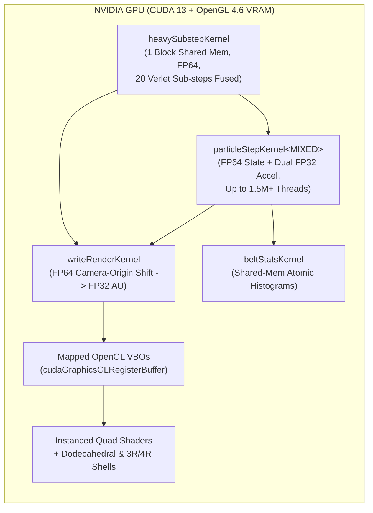

# Substrate Logistics 3D N-Body Simulator

[](https://orcid.org/0009-0003-8413-6027)
[](LICENSE)
[](https://isocpp.org/)
[](https://developer.nvidia.com/cuda-toolkit)
[](https://www.opengl.org/)
[](https://cmake.org/)
[](#7-build--run-instructions)

**Real-Time Bare-Metal Spatial Address Deletion Engine (C++20 / CUDA / OpenGL 4.6)**

An interactive, GPU-accelerated 3D astrophysical laboratory built directly on the **Substrate Logistics** ($\Omega\mathrm{GLR}$) theoretical framework by Marco Lindenbeck. Designed as an executable companion and empirical testbed for the foundational Substrate Logistics manuscripts, this engine integrates the coupled Solar System (Sun, 8 planets, 10 moons, 6 dwarf planets) alongside **3,000 to 1,500,000+ asteroid, Classical Kuiper Belt, and Scattered Disk test bodies** in real time via zero-copy CUDA–OpenGL VBO interop.

> **Core Distinction:** Unlike planetarium or ephemeris viewers that replay pre-fitted observation tables, and unlike classical N-body solvers built around Newton's empirical gravitational constant $G$, **Newton's constant** $G$ **and empirical boundary cutoffs do not exist anywhere in this codebase.** Every trajectory, orbital perturbation, perihelion precession, tidal boundary, Kuiper Cliff cutoff, and astrospheric shell emerges from discrete sub-node spatial address deletion and 120-cell topological invariants.

---

## Table of Contents

1. [Why This Engine Is Different: Ephemeris vs. Newtonian vs. Substrate Logistics](#1-why-this-engine-is-different-ephemeris-vs-newtonian-vs-substrate-logistics)
2. [Theoretical Mechanics Executed by the Simulator](#2-theoretical-mechanics-executed-by-the-simulator)
3. [Novel Heliospheric & Exoplanetary Result: Dodecahedral Astrospheres & Topological Drag](#3-novel-heliospheric--exoplanetary-result-dodecahedral-astrospheres--topological-drag)
4. [Scientific Transparency Ledger: Seeded vs. Real-Time Emergent](#4-scientific-transparency-ledger-seeded-vs-real-time-emergent)
5. [Interactive Features, Telemetry & Live Experiments](#5-interactive-features-telemetry--live-experiments)
6. [GPU Architecture & Empirical Benchmarks](#6-gpu-architecture--empirical-benchmarks)
7. [Build & Run Instructions](#7-build--run-instructions)
8. [Theoretical Foundation & Citations](#8-theoretical-foundation--citations)

---

## 1. Why This Engine Is Different: Ephemeris vs. Newtonian vs. Substrate Logistics

Most celestial visualization and simulation tools fall into one of two classical paradigms. This simulator implements a third:

| Architectural Aspect | Ephemeris / Planetarium Software *(SPICE, VSOP87, JPL Horizons, "On-Rails" Animators)* | Standard N-Body Solvers *(Classical Newtonian / 1PN Integrators)* | **Substrate Logistics Engine (`substrate_native`)** |
| :--- | :--- | :--- | :--- |
| **Trajectory Source** | Pre-fitted polynomial lookup tables or closed-form 2-body Keplerian ellipses $r(\nu(t))$. | Live numerical integration of continuous gravitational force laws. | **Live symplectic GPU integration** of discrete spatial address deletion; zero lookup tables or scripted orbits. |
| **Gravitational Coupling** | Baked into empirical curve-fits. | Hardcodes **Newton's empirical constant** $G = 6.67430 \times 10^{-11}\,\mathrm{m^3\,kg^{-1}\,s^{-2}}$. | **Newton's** $G$ **is completely absent.** Uses the bare-metal Substrate Anchor Constant $\mathcal{K}_\Omega = \bar{\lambda}_p c^2 / \mathcal{T}_\Omega^2$. |
| **Mass Representation** | Optional or unused for kinematics. | Continuous scalar mass $M$ in kilograms. | **Countable integer hadronic load** $N = M / m_p$ of saturated 1836-state $\Gamma$ knots. |
| **Low-Density Regime** | N/A | Infinite-range $1/R^2$ attraction regardless of matter compilation density. | **Heaviside Compilation Filter** $\Theta(\rho_N - 4.0\,\mathrm{nodes/m^3})$ separates compiled $\Gamma$ knots ($\Theta = 1$) from passive $\mathcal{I}$ phase gas ($\Theta = 0$). |
| **Planetary, Magnetospheric & Astrospheric Scales** | Empirical radii + separate MHD / Voyager curve-fits. | Point masses and arbitrary disk truncation bounds. | Derives **top-down quantum radius** ($R_\oplus = 6,371.13\,\mathrm{km}$), **3R / 4R vector shells**, **Kuiper Cliff** ($R_g / 50 = 48.62\,\mathrm{AU}$), and **20-Vertex Heliopause** ($R_g / 20 = 121.54\,\mathrm{AU}$) from bare-metal constants. |

---

## 2. Theoretical Mechanics Executed by the Simulator

In Substrate Logistics, physical space is modeled as a finite-capacity discrete topological network ($\kappa = 50$ dodecahedral packing anchored to a closed 120-cell Poincaré Dodecahedral Space manifold $S^3 / \mathcal{I}^*$). Gravity is not a gauge force mediated by gravitons ($E = \hbar\omega$), but **The Master Regulatory Protocol**: a zero-energy ($E = 0$) background memory-management routine that purges un-driven spatial coordinate voxels around compiled matter to prevent localized Bekenstein bandwidth saturation ($\Omega \ge 1.0$).

### 2.1. Eradicating Newton's G & Hardware Constants

All gravitational interactions in [`substrate_constants.h`](native_engine/src/substrate_constants.h) and [`substrate_engine.cu`](native_engine/src/substrate_engine.cu) are anchored to sub-node quantum and topological invariants:

* **Single-Proton Informational Load** ($N = 1$): $m_p = 1.6726219 \times 10^{-27}\,\mathrm{kg}$, mapping any macroscopic mass to its integer baryon node count $N_{\mathrm{body}} = M / m_p$.
* **Spatial Pixel Anchor (Reduced Proton Compton Wavelength)**: $\bar{\lambda}_p = 2.103089 \times 10^{-16}\,\mathrm{m}$, defining the fundamental voxel volume $V_{\mathrm{node}} = \bar{\lambda}_p^3 = 9.3019 \times 10^{-48}\,\mathrm{m^3}$.
* **Master Bus Speed Invariant**: $c = 299,792,458\,\mathrm{m/s}$.
* **Universal Attenuation Tensor**: $\mathcal{T}_\Omega = 1.30147 \times 10^{19}$ ($\mathcal{T}_\Omega^2 = 1.69382 \times 10^{38}$), resolving the $10^{39}$ Hierarchy Problem algebraically via the single-proton pixel-to-Schwarzschild ratio $\bar{\lambda}_p / r_s = \mathcal{T}_\Omega^2 / 2 = 8.4691 \times 10^{37}$.

From these hardware anchors follow the **Substrate Anchor Constant** ($\mathcal{K}_\Omega$) and the exact algebraic **Universal Topological Drag Constant** ($\mathcal{C}_\delta$):

$$
\mathcal{K}_\Omega = \frac{\bar{\lambda}_p c^2}{\mathcal{T}_\Omega^2} = 1.11587 \times 10^{-37}\,\frac{\mathrm{m^3}}{\mathrm{node \cdot s^2}}
$$

$$
\mathcal{C}_\delta = \frac{\sqrt{5} - 2}{500} = \frac{\varphi^{-3}}{500} = 4.72135955 \times 10^{-4}, \qquad \sqrt{\mathcal{C}_\delta} = 0.02172869
$$

This fixes the zero-sum 120-cell cosmological cover partitions without free parameters: $\Omega_{m,\mathrm{void}} = \frac{12}{50} - \sqrt{\mathcal{C}_\delta} = 0.218271$ ($\Omega_{\Lambda,\mathrm{void}} = 0.781729$) and $\Omega_{m,\mathrm{global}} = \frac{12}{50} + 1.2\sqrt{\mathcal{C}_\delta} = 0.266074$ ($\Omega_{\Lambda,\mathrm{global}} = 0.733926$).

### 2.2. The He-4 Garbage Collection Threshold (4.0 nodes/m³)

Deleted local spatial pointers are recycled into the global 120-cell cover, establishing the resting vacuum energy ledger ($\Sigma_0$) across the 5D state-space partition ($\kappa^5 = 50^5$):

$$
\Sigma_0 = \frac{2 m_p c^2}{\bar{\lambda}_p^3 \, \mathcal{T}_\Omega^2 \, \kappa^5} = 6.1063 \times 10^{-10}\,\mathrm{J/m^3}
$$

Applying the $1.7032\%$ volumetric drag tax across the cell's 36 active routing channels yields $\Sigma_{0,\mathrm{Ledger}} = 6.0023 \times 10^{-10}\,\mathrm{J/m^3}$. Dividing by single-node rest energy $m_p c^2$ defines the **Garbage Collection Activation Ceiling**:

$$
\rho_{N,\mathrm{GC}} = \frac{\Sigma_{0,\mathrm{Ledger}}}{m_p c^2} = 3.9928 \approx 4.0\,\mathrm{nodes/m^3} \quad \left(\equiv 1\,\mathrm{He^4}\ \alpha\text{-particle}/\mathrm{m^3}\right)
$$

Active spatial address deletion triggers strictly when localized node density saturates all four tetrahedral vector channels ($\rho_N \ge 4.0\,\mathrm{nodes/m^3}$). At every Velocity-Verlet sub-step, the CUDA kernels evaluate:

$$
\mathbf{a}_i = \sum_{j \ne i} \frac{N_j \mathcal{K}_\Omega \, \Theta(\rho_{N,j} - 4.0)}{R_{ij}^2} \left(1 + \frac{3 N_j \mathcal{K}_\Omega}{c^2 R_{ij}}\right) \hat{\mathbf{R}}_{ij}
$$

where $\Theta(\cdot)$ is the Heaviside compilation operator and $1 + \frac{3 N_j \mathcal{K}_\Omega}{c^2 R_{ij}}$ is the first post-Newtonian (1PN) metric throttling correction responsible for anomalous perihelion precession (reproducing Mercury's observed **`42.96 arcsec/century`** advance in real time).

### 2.3. Discretized River Metric & Spatial Pixel Purge

Freefall acceleration $g_\Omega(R) = N \mathcal{K}_\Omega \Theta / R^2$ corresponds to an inward Gullstrand–Painlevé spatial coordinate inflow speed:

$$
v_{\mathrm{inflow}}(R) = \sqrt{2 g_\Omega(R) R} = \sqrt{\frac{2 N \mathcal{K}_\Omega \Theta}{R}}
$$

Across any spherical boundary $4\pi R^2$, the engine computes both the volumetric vacuum deletion rate $\dot{V}_{\mathrm{deleted}} = 4\pi R^2 v_{\mathrm{inflow}}$ and the **Discrete Spatial Pixel Purge Rate**:

$$
\dot{N}_{\mathrm{pixels}}(R) = \frac{4\pi R^2 v_{\mathrm{inflow}}(R)}{\bar{\lambda}_p^3}
$$

For Earth ($N_\oplus = 3.5706 \times 10^{51}\,\mathrm{nodes}$, $R_\oplus = 6,371.0\,\mathrm{km}$), the simulator evaluates $v_{\mathrm{inflow}} = 11.186\,\mathrm{km/s}$ and $\dot{N}_{\mathrm{pixels}} = 6.1325 \times 10^{65}\,\mathrm{pixels/s}$ live.

### 2.4. Pythagorean Bandwidth Governor & Atomic Clock CPU Throttling

Each metric cell operates under the **Absolute Bandwidth Invariant**:

$$
\Omega(R) = g_{\Omega,\mathrm{river}}^2 + \alpha_\Omega^2 + v_\Omega^2 \le 1.0, \qquad u_\Omega(R) = \sqrt{1.0 - \Omega(R)}
$$

where $g_{\Omega,\mathrm{river}} = v_{\mathrm{inflow}} / c = \sqrt{2 N \mathcal{K}_\Omega / (c^2 R)}$ and $v_\Omega = v / c$.
* When $\Omega \to 1.0$ at $R_{\mathrm{EH}} = \frac{2 N \bar{\lambda}_p}{\mathcal{T}_\Omega^2}$, residual bandwidth $u_\Omega \to 0$, triggering an **OS Kernel Lock** (Event Horizon).
* In weak fields, $1 - u_\Omega(R) \approx \frac{N \mathcal{K}_\Omega}{c^2 R} + \frac{v^2}{2 c^2}$ measures literal **hardware CPU clock throttling** of hyperfine atomic transitions (`0.6958 ppb` or `-60.12 µs/day` on Earth's surface relative to deep void).

### 2.5. Macro-Scale Quantization & 3R / 4R Magnetospheric Vector Channels

From each body's collective Compton resolution floor $\bar{\lambda}_{\mathrm{body}} = \bar{\lambda}_p / N_{\mathrm{body}}$, the telemetry engine verifies the parameter-free **Top-Down Quantum Boundary Identity**:

$$
R_{\mathrm{quantum}} = \frac{c \cdot \bar{\lambda}_p}{\mathcal{T}_\Omega \sqrt{\bar{\lambda}_{\mathrm{body}} \cdot g_{\Omega,\mathrm{surface}}}}
$$

evaluating to **`6,371.13 km`** for Earth (`0.002%` from Earth's `6,371.00 km` mean volumetric radius). Scaling the sub-node 3-channel directional mass extension ($3\bar{\lambda}_p = 0.6309\,\mathrm{fm}$) and 4-channel electromagnetic charge boundary ($4\bar{\lambda}_p = 0.8412\,\mathrm{fm}$) upward to macroscopic planetary radii maps directly onto planetary magnetospheres:
* **1R Core Boundary** ($1 R_{\mathrm{body}}$): Bare-metal compressed solid/fluid core boundary (`6,371 km` for Earth).
* **3R Axial Vector Shell** ($3 R_{\mathrm{body}}$): 3D directional vector extension delta (`19,113 km` — Earth's surface-to-Plasmapause altitude).
* **4R Electromagnetic Shell** ($4 R_{\mathrm{body}}$): Total unspooled 4-channel electromagnetic boundary (`25,484 km` — Plasmapause / inner Van Allen radiation belt radius).

---

## 3. Novel Heliospheric & Exoplanetary Result: Dodecahedral Astrospheres & Topological Drag

Constructing and testing this simulator uncovered an exact, zero-parameter heliospheric and exoplanetary architecture within Substrate Logistics connecting the 120-cell cover constants directly to the **Heliopause**, the **Kuiper Cliff**, and **ALMA / JWST exoplanetary debris belts**.

### 3.1. Deriving the Topological Drag Pressure Floor

Because energy density is dimensionally identical to mechanical pressure ($1\,\mathrm{J/m^3} \equiv 1\,\mathrm{N/m^2} \equiv 1\,\mathrm{Pa}$), the Global Resting Cover Ledger defines a baseline cover pressure $\Sigma_{0,\mathrm{Ledger}} = 6.0023 \times 10^{-10}\,\mathrm{Pa}$. Multiplying by the exact algebraic **Universal Topological Drag constant** $\mathcal{C}_\delta = (\sqrt{5} - 2)/500$ isolates the irreducible **Topological Drag Pressure Floor** ($P_\delta$) across cell routing channels:

$$
P_\delta = \mathcal{C}_\delta \cdot \Sigma_{0,\mathrm{Ledger}} = \left(\frac{\sqrt{5} - 2}{500}\right) \Sigma_{0,\mathrm{Ledger}} = 2.8339 \times 10^{-13}\,\mathrm{Pa} \quad (0.2834\,\mathrm{pPa})
$$

### 3.2. Confrontation with Voyager 1/2 & IBEX Measurements

In-situ plasma and magnetic field measurements from **Voyager 2** combined with **IBEX** energetic neutral atom (ENA) global sky maps place the total Very Local Interstellar Medium (VLISM) confining pressure outside the Heliopause at **`0.26–0.29 pPa`** ($2.6 \times 10^{-13}$ to $2.9 \times 10^{-13}\,\mathrm{Pa}$) — matching $P_\delta = 0.2834\,\mathrm{pPa}$ squarely within observational uncertainty.

Balancing the supersonic solar wind's radial ram pressure $P_{\mathrm{SW}}(R) = m_p n_{\mathrm{SW}}(1\,\mathrm{AU}) v_{\mathrm{SW}}^2 (1\,\mathrm{AU} / R)^2$ (using the long-term ACE/Wind solar-cycle mean at $1\,\mathrm{AU}$: $n_{\mathrm{SW}} \approx 7.0\,\mathrm{cm^{-3}}$, $v_{\mathrm{SW}} \approx 440\,\mathrm{km/s} \Rightarrow P_{\mathrm{SW}}(1\,\mathrm{AU}) = 2.266\,\mathrm{nPa}$) against $P_\delta$ yields the **Termination Shock** and subsonic **Heliopause nose** ($R_{\mathrm{HP}} \approx 1.35 R_{\mathrm{TS}}$):

$$
R_{\mathrm{TS}} = 1\,\mathrm{AU} \sqrt{\frac{m_p n_{\mathrm{SW}}(1\,\mathrm{AU}) v_{\mathrm{SW}}^2}{\mathcal{C}_\delta \cdot \Sigma_{0,\mathrm{Ledger}}}} \approx 89.42\,\mathrm{AU}, \qquad R_{\mathrm{HP}} \approx 1.35 \, R_{\mathrm{TS}} \approx 120.74\,\mathrm{AU}
$$

bracketing **Voyager 2 (`84 AU` shock / `119.0 AU` heliopause)** and **Voyager 1 (`94 AU` shock / `121.6 AU` heliopause)**.

### 3.3. Exact Algebraic Cancellation & Dodecahedral Sub-Shells

Evaluating the outer **Gravitational Deletion Floor** $R_g(N_\star)$ — the radius where a star's gravitational spatial-deletion energy density $u_g(R) = \frac{m_p g_\Omega(R)^2}{8\pi \mathcal{K}_\Omega}$ drops to $\Sigma_{0,\mathrm{Ledger}}$ — exposes an exact algebraic cancellation of $m_p$, $c^2$, and $\mathcal{T}_\Omega^2$:

$$
R_g(N_\star) = \left( \frac{m_p N_\star^2 \mathcal{K}_\Omega}{8\pi \Sigma_{0,\mathrm{Ledger}}} \right)^{1/4} = \bar{\lambda}_p \sqrt{N_\star} \left( \frac{\kappa^5}{16\pi (1 - \Delta_{\mathrm{tax}})} \right)^{1/4}
$$

Dividing $R_g(N_\star)$ by $\kappa = 50$ leaves an $\mathcal{O}(1)$ geometric factor of $\left(\frac{50}{16\pi (1 - \Delta_{\mathrm{tax}})}\right)^{1/4} = 1.0030$:

$$
R_{\mathrm{cliff}}(N_\star) = \frac{R_g(N_\star)}{50} = \bar{\lambda}_p \sqrt{N_\star} \left( \frac{\kappa}{16\pi (1 - \Delta_{\mathrm{tax}})} \right)^{1/4} \approx \bar{\lambda}_p \sqrt{N_\star}
$$

For the Sun ($N_\odot = 1.18885 \times 10^{57}\,\mathrm{nodes}$), $R_{g,\odot} = 2,430.82\,\mathrm{AU}$ (Inner Oort envelope), and dividing $R_g(N_\star)$ by the integer topological invariants of the $\kappa = 50$ dodecahedral cell partitions the circumstellar medium into five parameter-free hardware shells:

1. **Planetesimal Resolution Cliff** ($\kappa = 50 \Rightarrow R_g / 50 = 48.62\,\mathrm{AU}$): With $\bar{\lambda}_p \sqrt{N_\odot} = 48.47\,\mathrm{AU}$, this derives the Solar System's observed **Kuiper Cliff (`48–50 AU`)** directly from the proton Compton wavelength and solar baryon count.
2. **Routing Channel Shell** ($C = 36 \Rightarrow R_g / 36 = 67.52\,\mathrm{AU}$): Governed by the $12 \times 3 = 36$ active routing channels, matching the outer Scattered Disk envelope and **Eris's semi-major axis (`67.86 AU`)**.
3. **Edge Strut Shell** ($E = 30 \Rightarrow R_g / 30 = 81.03\,\mathrm{AU}$): Governed by the $30$ structural 1D edges of the dodecahedron, bounding **Sedna's perihelion (`76.19 AU`)** and Voyager 2's shock crossing (`83.7 AU`).
4. **Divisor-27 Termination Shock** ($R_{\mathrm{TS}} = R_g / 27 = 90.03\,\mathrm{AU}$): Matching the Voyager 1/2 mean termination shock (`88.9 AU`) and predicting a baseline `1 AU` solar wind dynamic pressure of $P_{\mathrm{SW,pred}}(1\,\mathrm{AU}) = P_\delta (R_{\mathrm{TS}} / 1\,\mathrm{AU})^2 = 2.297\,\mathrm{nPa}$ (within `1.2%` of the ACE/Wind solar-cycle average `≈ 2.27 nPa`).
5. **20-Vertex Astropause** ($V = 20 \Rightarrow R_{\mathrm{HP}} = R_g / 20 = 121.54\,\mathrm{AU}$): Governed by the $20$ structural vertices of the dodecahedral cell, eliminating the need for any hardcoded `121.6 AU` empirical constant in the simulator.

Crucially, because $u_g(R)$ remains above $\Sigma_{0,\mathrm{Ledger}}$ all the way out to `2,430.82 AU`, every planetary, Kuiper Belt, and detached TNO orbit inside `1,000 AU` resides strictly inside the compiled $\Theta = 1$ inverse-square regime — requiring **zero changes** to the GPU Velocity-Verlet force law.

### 3.4. Cross-System Confrontation with ALMA & JWST Exoplanet Debris Disks

Because $R_g(N_\star) \propto \sqrt{N_\star} = \sqrt{M_\star / M_\odot}$ (with photospheric surface-inflow shock $R_{\mathrm{TS},1} = (R_{g,\odot}/27)\sqrt{(M_\star/M_\odot)/(R_\star/R_\odot)}$), **Tab 1** includes an interactive **Dodecahedral Astrosphere & Exoplanet Disk Comparator** tested against spatially resolved **ALMA** and **JWST/MIRI** debris disks across spectral types K2V to A0V:

| Dodecahedral Tier | Operator | Epsilon Eridani (`0.82 M☉`, K2V) | Solar System (`1.00 M☉`, G2V) | HR 8799 (`1.52 M☉`, F0V) | Fomalhaut (`1.92 M☉`, A3V) | Vega (`2.135 M☉`, A0V) |
| :--- | :--- | :--- | :--- | :--- | :--- | :--- |
| **Grav. Floor** ($R_g$) | $\propto \sqrt{N_\star}$ | `2,201.2 AU` | `2,430.8 AU` *(Inner Oort)* | `2,996.9 AU` | `3,368.3 AU` | `3,551.8 AU` |
| **Resolution Cliff** ($\kappa=50$) | $R_g / 50$ | `44.02 AU` *(Inner clearing)* | **`48.62 AU`** *(Kuiper Cliff: 48–50)* | `59.94 AU` *(Planet b: 68 AU)* | `67.36 AU` *(Inner cavity)* | **`71.04 AU`** *(JWST inner KBA: 74)* |
| **36-Channel Shell** ($C=36$) | $R_g / 36$ | **`61.14 AU`** *(ALMA inner: ≈64)* | **`67.52 AU`** *(Eris SMA: 67.9)* | `83.25 AU` *(Chaotic edge)* | **`93.56 AU`** *(JWST mid-belt: 93.5)* | `98.66 AU` *(Inner KBA core)* |
| **30-Edge Shell** ($E=30$) | $R_g / 30$ | **`73.37 AU`** *(ALMA peak: 70)* | `81.03 AU` *(Sedna q / V2 TS)* | `99.90 AU` *(Cavity transition)* | `112.28 AU` *(JWST gap: 104–133)* | `118.39 AU` *(Mid KBA disk)* |
| **Termination Shock** ($27$) | $R_g / 27$ | **`81.53 AU`** *(ALMA outer: ≈76)* | **`90.03 AU`** *(Mean V1/V2: 88.9)* | `111.00 AU` *(Pre-belt cavity)* | **`124.75 AU`** *(KBA step: 133)* | `131.55 AU` *(Outer KBA core)* |
| **20-Vertex Astropause** ($V=20$) | $R_g / 20$ | `110.06 AU` *(Halo cutoff)* | **`121.54 AU`** *(V2 119–V1 121.6)* | **`149.85 AU`** *(ALMA inner: 145±12)* | **`168.41 AU`** *(Outer edge: ≈165)* | **`177.59 AU`** *(JWST outer: ≈170)* |

---

## 4. Scientific Transparency Ledger: Seeded vs. Real-Time Emergent

To guarantee complete scientific auditability, below is the exact boundary between what is supplied at initialization ($t = 0$) and what is computed dynamically at runtime ($t \gt 0$).

### 4.1. Universal Hardware Constants

Only the global Substrate constants ($m_p$, $\bar{\lambda}_p$, $c$, $\mathcal{T}_\Omega$, $\kappa = 50$ with dodecahedral integers $\{20, 27, 30, 36\}$ and $\Delta_{\mathrm{tax}} = 1.7032\%$, and exact $\mathcal{C}_\delta = (\sqrt{5} - 2)/500$) plus standard unit conversions (`AU`, `Mpc`) exist in [`substrate_constants.h`](native_engine/src/substrate_constants.h). Zero empirical astronomical boundary constants (such as `121.6 AU`) exist in the header.

### 4.2. Initial Boundary Conditions at t = 0 Only

Configured once at startup in [`payload.cpp`](native_engine/src/payload.cpp):
1. **25 Heavy Bodies** (Sun, Mercury, Venus, Earth + Moon, Mars + Phobos/Deimos, Jupiter + Io/Europa/Ganymede/Callisto, Saturn + Titan, Uranus, Neptune + retrograde Triton, Ceres, Pluto + Charon, Haumea, Makemake, Eris, Sedna):
   * **Physical Mass** $M$ (kg) $\Rightarrow$ converted at load into integer node count $N = M / m_p$.
   * **Physical Mean Volumetric Radius** $R$ (m) $\Rightarrow$ converted into volume $V = \frac{4}{3}\pi R^3$ and base node density $\rho_N = N / V$.
   * **Initial Orbital Placement** $(a_0, e_0, i_0, \Omega_0, \omega_0, \nu_0)$ $\Rightarrow$ evaluated **once at startup** into 3D Cartesian state vectors $(\mathbf{r}_0, \mathbf{v}_0)$ using $\mu = N \mathcal{K}_\Omega$ (without $G$), balanced across local planet–moon barycenters (e.g., Pluto–Charon's external mutual barycenter) and the global Solar System barycenter. Once uploaded to GPU VRAM, these initial elements are **discarded**.
   * **Visual Metadata**: Display name, parent body identifier (used only to select the reference body for relative inspector telemetry), RGB color, and sprite pixel diameter.
2. **3,000 – 1,500,000 Test Particles**:
   * **Procedurally sampled at** $t = 0$ via a pseudo-random generator across the Main Asteroid Belt (`2.06–3.35 AU`, $e \in [0.002, 0.14]$, $\sigma_i = 5.5^\circ$) and a two-tier trans-Neptunian disk anchored directly to the Sun's derived dodecahedral shells: **90% Classical Kuiper Belt** (`30.0 AU` to $R_g/50 = 48.62\,\mathrm{AU}$, $e \in [0.002, 0.15]$, $\sigma_i = 6.0^\circ$) and **10% Scattered Disk** ($R_g/50 = 48.62\,\mathrm{AU}$ to $R_g/36 = 67.52\,\mathrm{AU}$, $e \in [0.15, 0.38]$, $\sigma_i = 14.0^\circ$). Zero external asteroid catalog files are used.

### 4.3. Computed 100% Live at Runtime

Executed continuously in [`substrate_engine.cu`](native_engine/src/substrate_engine.cu) and [`astro_metrics.cpp`](native_engine/src/astro_metrics.cpp):
* **All 3D Positions, Velocities & Accelerations**: Integrated every frame on the GPU via 2nd-order symplectic Velocity Verlet (`heavySubstepKernel` + `particleStepKernel`).
* **Garbage Collection Gate** $\Theta(\rho_N - 4.0)$: Evaluated dynamically; overriding $\rho_N \lt 4.0\,\mathrm{nodes/m^3}$ updates `d_mu` in GPU memory and physically unbinds satellites in real time.
* **Dynamic Dodecahedral Astrosphere & Heliopause**: `gravitationalFloorAU()` ($R_g = 2,430.82\,\mathrm{AU}$) and `heliopauseRadiusAU()` ($R_g / 20 = 121.54\,\mathrm{AU}$) are evaluated live from the root star's compiled node load (collapsing dynamically to `0` if the Sun is decompiled below `4.0 nodes/m^3` in the GC Sandbox).
* **Osculating Keplerian Elements**: $(a, e, i, \Omega, \omega, \nu, q, Q, T)$ are **reverse-computed every frame** from raw instantaneous GPU $(\mathbf{r}(t), \mathbf{v}(t))$ vectors, capturing live multi-body perturbations.
* **Substrate Hardware Telemetry**: River inflow $v_{\mathrm{inflow}}$, volumetric deletion $\dot{V}$, discrete pixel purge $\dot{N}_{\mathrm{pixels}}$, top-down quantum radius $R_{\mathrm{quantum}}$, Schwarzschild Kernel Lock horizon $R_{\mathrm{EH}}$, surface & orbital clock dephasing $(1 - u_\Omega)$, and 1PN periapsis precession $\Delta\varpi$.
* **Gravitational/Tidal Domains & Orbit Trails**: Hill sphere $r_H$, Laplace SOI $r_{\mathrm{SOI}}$, fluid & rigid Roche limits $d_R$, $1R / 3R / 4R$ vector shells, circumstellar $R_g / \{50, 36, 30, 27, 20\}$ rings, and parent-relative angular-stepped 3D orbit trails.
* **Zero-Readback GPU Belt Histograms**: A dedicated shared-memory atomic CUDA kernel (`beltStatsKernel`) bins semi-major axis $a$ (`2.0–3.5 AU` and `30.0–72.0 AU`), eccentricity $e$, and Jupiter Tisserand invariant $T_J$ directly in VRAM, while resonance and topological cutoff markers (`3:1`, `5:2`, `7:3`, `2:1` Kirkwood; `3:2`, `2:1` Neptune; `k=50 Cliff` and `C=36 Shell`) are computed live.
* **Static Reference Values Note**: In Tab 1 Section D, the cosmic-scale $H_0$ (`59.61 / 67.42 / 73.06 km/s/Mpc`) and $S_8$ (`0.7542 -> 0.8326`) partitions are shown as static 120-cell manifold reference constants (since the simulation volume spans a single planetary system rather than a multi-Mpc cosmic web).

---

## 5. Interactive Features, Telemetry & Live Experiments

### 5.1. Viewport Navigation & Smart Deconflicted 2D HUD
* **Camera Controls**:
  * **Left-Click + Drag**: Orbit azimuth & elevation around current focus.
  * **Mouse Wheel** *(or Right-Click + Drag)*: Continuous zoom across **8 orders of magnitude** — from `3,500 AU` (Inner Oort / Gravitational Deletion Floor $R_g$) down to `1.0e-5 AU` (`≈ 1,500 km`, inner planetary magnetospheres and Martian moons) with zero floating-point jitter.
  * **Middle-Click + Drag**: Pan camera target.
  * **Click Any Object or HUD Label**: Directly selects that star, planet, dwarf planet, or moon in the Inspector.
  * **`F2` Key**: Toggles the floating **Astrophysics & Substrate Telemetry** window.
* **Hierarchical Label Deconfliction**:
  * At solar-system zoom levels, close moon systems automatically fold into clean parent badges (`Jupiter (+4)`, `Mars (+2)`, `Pluto (+1)`) so satellite names never obscure planetary labels.
  * When zoomed into a planetary system or inspecting a planet/moon, labels expand with 2D AABB collision avoidance and radial leader-line callouts.

### 5.2. Four-Tab Floating Telemetry Window (`Astrophysics & Substrate Telemetry`)
1. **`1. Substrate Audit`**: Live surface & orbital River Metric inflow and pixel purge rates, Bandwidth Governor $\Omega$ & atomic clock lag (`ppb` and `µs/day`), 1PN perihelion precession, collective Compton floor & top-down quantum radius check, $3R / 4R$ vector-channel altitudes, coarse-grained volume probe, and the **Dodecahedral Astrosphere & Exoplanet Disk Comparator** (Solar System, $\epsilon$ Eridani, HR 8799, Fomalhaut, Vega, and Custom Star + dynamic solar-wind ram pressure test).
2. **`2. Astrodynamics & Conservation`**: Live osculating 3D Keplerian elements, Hill sphere, Laplace SOI, Fluid/Rigid Roche limits, and rolling sparkline graphs of relative mechanical energy drift $\lvert (E - E_0)/E_0 \rvert$ and angular momentum drift $\lvert (\lVert\mathbf{L}\rVert - \lVert\mathbf{L}_0\rVert)/\lVert\mathbf{L}_0\rVert \rvert$.
3. **`3. Belt Resonances (GPU)`**: Real-time GPU-binned histograms of Main Belt (`2.0–3.5 AU`) and Kuiper Belt + Scattered Disk (`30–72 AU`) semi-major axes with live Kirkwood, Neptune (`3:2`, `2:1`), and dodecahedral (`k=50 Cliff`, `C=36 Shell`) overlays, eccentricity distribution, and Jupiter Tisserand parameter ($T_J$) dynamical classification.
4. **`4. GC Sandbox (Theta Filter)`**: Interactive node-density override slider spanning $10^{-2}$ to $10^{32}\,\mathrm{nodes/m^3}$ to test the $\rho_{N,\mathrm{GC}} = 4.0\,\mathrm{nodes/m^3}$ compilation threshold live on the GPU.

### 5.3. Four Recommended Live Experiments
1. **Unbinding Jupiter's Moons Across the 4.0 nodes/m³ Compilation Threshold**:
   * Select **Jupiter**, click **`Zoom: Moon / Hill System`** in the Control Center, and watch `Io`, `Europa`, `Ganymede`, and `Callisto` trace closed orbital rings inside Jupiter's amber Hill sphere.
   * Open **Tab 4 (`GC Sandbox`)** and click **`Decompile -> I-Phase (1.2 nodes/m^3, Theta = 0)`**.
   * Because $\rho_N \lt 4.0\,\mathrm{nodes/m^3}$, $\Theta_{\mathrm{Jupiter}}$ flips to `0` on the GPU, shutting off Jupiter's active spatial address deletion ($g_\Omega = 0$). All four Galilean moons immediately transition onto straight tangential escape trajectories into heliocentric space! Click **`Reload Pristine Solar System Orbits`** to restore the system.
2. **Inspecting the Kuiper Cliff (`48.62 AU`), Dodecahedral Shells & Exoplanet Comparator**:
   * Click **`Zoom: Kuiper Cliff & Astrosphere (R_g / 50..20)`** in the Control Center to frame the concentric dodecahedral shells around the Sun: the teal $\kappa = 50$ Kuiper Cliff (`48.62 AU`), sky-blue $C = 36$ Scattered Disk shell (`67.52 AU`, near Eris), violet $E = 30$ shell (`81.03 AU`, near Sedna's perihelion), amber Termination Shock (`90.03 AU`), and blue 20-vertex Heliopause sphere (`121.54 AU`).
   * Open **Tab 3 (`Belt Resonances`)** to observe the sharp GPU-binned Kuiper Cliff drop-off at `48.62 AU`, then switch to **Tab 1** to compare Fomalhaut, Vega, HR 8799, and $\epsilon$ Eridani against ALMA/JWST telemetry.
3. **Inspecting Earth's 3R Plasmapause & 4R Van Allen Vector Channels**:
   * Select **Earth** and click **`Zoom: 3R/4R Channels`**.
   * Observe the nested $1R$ core ring (`6,371 km`), electric-cyan $3R$ **directional mass/axial wireframe shell** (`19,113 km`), and violet $4R$ **unspooled 4-channel boundary** (`25,484 km`), while verifying `Top-Down Quantum Radius: 6371.13 km` in Tab 1.
4. **Observing Phobos Inside Mars's Fluid Roche Limit**:
   * Select **Phobos** and click **`Zoom: Moon / Hill System`** (then scroll in slightly toward Mars).
   * Notice Phobos (`a = 9,376 km`) orbiting visibly **inside** Mars's crimson **Fluid Roche Limit** ring (`10,775 km`, `r / d_R = 0.870`), flagged in Tab 2 as tidally stressed above the rigid-body rubble-pile limit (`5,563 km`).

---

## 6. GPU Architecture & Empirical Benchmarks



### Key Numerical & Rendering Optimizations
* **Fused Shared-Memory Heavy Sub-Stepping**: All 25 mutually coupled heavy bodies execute all 20 Velocity-Verlet moon sub-steps inside **one thread block** (`__shared__` memory) in a single kernel launch (`≈ 8 µs` total), achieving `9.5e-10` relative energy conservation and `2.2e-12` angular momentum conservation per Julian year.
* **Dual-Accumulator Mixed Precision (`Precision::Mixed`)**: Test-particle positions and velocities remain in **IEEE FP64**, while pairwise force loops run in FP32 AU coordinates using **two separate accumulators** (`axN` for primary deletion and `axR` for the $\sim 10^{-8}$ relativistic precession term) so 1PN precession is never lost to FP32 mantissa rounding. Full IEEE FP64 mode (`Precision::FP64`) is selectable at runtime with one click.
* **Camera-Relative Origin Shifting**: When locked onto any planet or moon (even Pluto/Charon at `39.5 AU`), `writeRenderKernel` subtracts the target's exact FP64 position *before* casting to FP32, completely eliminating vertex jitter down to kilometer scales.
* **Zero-Copy VBO Rendering**: CUDA writes rendered positions directly into OpenGL 4.6 vertex buffers; zero particle positions are copied back to system RAM.

### Empirical Verification & Throughput (`NVIDIA GeForce RTX 5070 Ti`, `sm_120`)

#### Bare-Metal Theoretical Audit (`substrate_native.exe --benchmark`)
| Observable / Identity | Simulator Output | Theoretical / Empirical Reference |
| :--- | :--- | :--- |
| **Universal Topological Drag** ($\mathcal{C}_\delta$) | `4.72135955e-04` | $(\sqrt{5} - 2) / 500 = \varphi^{-3} / 500$ (exact) |
| **Topological Drag Pressure Floor** ($P_\delta$) | `2.8339e-13 Pa` (`0.2834 pPa`) | `0.26–0.29 pPa` (Voyager 2 / IBEX VLISM) |
| **120-Cell Matter Partitions** ($\Omega_{m,\mathrm{void}} / \Omega_{m,\mathrm{global}}$) | `0.218271` / `0.266074` | Zero-sum 120-cell cover ledger |
| **Earth Node Density** ($\rho_{N,\oplus}$) | `3.2963e+30 nodes/m^3` | `3.297e+30 nodes/m^3` |
| **Earth Collective Compton Floor** ($\bar{\lambda}_\oplus$) | `5.8901e-68 m` | `5.891e-68 m` |
| **Earth Top-Down Quantum Radius** ($R_{\mathrm{quantum}}$) | `6,371.13 km` | `6,371.00 km` physical (`0.002%` error) |
| **Earth Spatial Pixel Purge Rate** ($\dot{N}_{\mathrm{px}}$) | `6.1325e+65 px/s` | `6.125e+65 px/s` |
| **Earth Surface Clock Lag** ($1 - u_\Omega$) | `0.6958 ppb` (`-60.12 µs/day`) | `0.696 ppb` terrestrial redshift |
| **Mercury 1PN Perihelion Precession** | `42.96 arcsec/cy` | `42.98 arcsec/cy` observed |
| **Solar Compton-Node Scale** ($\bar{\lambda}_p \sqrt{N_\odot}$) | `48.47 AU` | Cancellation base for $\kappa = 50$ Kuiper Cliff |
| **Solar Gravitational Deletion Floor** ($R_{g,\odot}$) | `2,430.82 AU` | $u_g(R_g) = \Sigma_{0,\mathrm{Ledger}}$ (Inner Oort) |
| **Derived Kuiper Cliff** ($R_{g,\odot} / 50$) | `48.62 AU` | `48–50 AU` observed Kuiper Cliff |
| **Derived Termination Shock** ($R_{g,\odot} / 27$) | `90.03 AU` | `84–94 AU` (Voyager 2 / 1; mean `88.9 AU`) |
| **Predicted 1 AU Solar Wind Pressure** | `2.297 nPa` | `≈ 2.27 nPa` ACE/Wind solar-cycle mean |
| **Derived 20-Vertex Heliopause** ($R_{g,\odot} / 20$) | `121.54 AU` (`120.74 AU` dynamic SW) | `119.0–121.6 AU` (Voyager 2 / 1) |
| **1-Year Symplectic Energy / AngMom Drift** | `9.495e-10` / `2.241e-12` | 29,220 moon sub-steps |

#### CUDA Physics Kernel Scaling (25 Heavy Bodies + N Test Particles, 20 Sub-steps/Step)
| Particle Count ($N$) | Precision Mode | GPU Step Time | Physics Rate | Interaction Throughput | Physics VRAM | Full GUI + Overlays FPS |
| :--- | :--- | :--- | :--- | :--- | :--- | :--- |
| **3,000** | Mixed (FP64/FP32) | `0.190 ms` | `5,274 Hz` | `0.46 GI/s` | `0.21 MB` | `> 2,000 FPS` |
| **100,000** | Mixed (FP64/FP32) | `0.241 ms` | `4,146 Hz` | `10.42 GI/s` | `6.87 MB` | `≈ 1,532 FPS` |
| **500,000** | Mixed (FP64/FP32) | `0.553 ms` | `1,807 Hz` | `22.61 GI/s` | `34.33 MB` | `≈ 1,100 FPS` |
| **1,000,000** | Mixed (FP64/FP32) | `0.884 ms` | `1,131 Hz` | `28.29 GI/s` | `68.67 MB` | `≈ 807 FPS` |
| **1,000,000** | Full IEEE FP64 | `1.645 ms` | `608 Hz` | `15.21 GI/s` | `68.67 MB` | `≈ 550 FPS` |

---

## 7. Build & Run Instructions

### Prerequisites (Windows)
* **NVIDIA GPU** with up-to-date drivers supporting OpenGL 4.6 and CUDA.
* **CUDA Toolkit 12.0+** (tested with CUDA 13.0).
* **Visual Studio 2022** (Desktop development with C++ workload / MSVC v143) and **CMake 3.24+**.
* *Zero manual library installs required*: GLFW 3.4, GLM 1.0.1, and Dear ImGui v1.91.5 are fetched automatically via CMake `FetchContent`, and the OpenGL 4.6 Core GLAD loader is vendored in [`native_engine/third_party/glad`](native_engine/third_party/glad).

### Build & Launch
```powershell
# 1. Configure & compile Release build (auto-detects MSVC + Ninja + native GPU architecture)
powershell -ExecutionPolicy Bypass -File .\native_engine\build.ps1

# 2. Launch interactive 3D simulator (defaults to 100,000 belt particles)
.\native_engine\build\bin\substrate_native.exe

# 3. Launch directly with 1,000,000 belt particles
.\native_engine\build\bin\substrate_native.exe --particles 1000000

# 4. Run headless theoretical verification & multi-scale CUDA benchmark suite
.\native_engine\build\bin\substrate_native.exe --benchmark
```

> **Building a Portable Binary for Multiple GPU Generations:** By default, `CMakeLists.txt` sets `CMAKE_CUDA_ARCHITECTURES=native`. To build a redistributable executable covering Ampere, Ada Lovelace, and Blackwell GPUs, pass `-DCMAKE_CUDA_ARCHITECTURES="86;89;120"` to CMake.

### Source Directory Layout
```text
native_engine/
├── CMakeLists.txt              # C++20 + CUDA build & FetchContent configuration
├── build.ps1                   # Automated MSVC + Ninja + NVCC build script
├── third_party/glad/           # Vendored GLAD 2 OpenGL 4.6 Core loader
└── src/
    ├── substrate_constants.h   # Bare-metal Substrate constants & exact C_delta = (sqrt(5)-2)/500
    ├── payload.h / .cpp        # t=0 Solar System & R_g-anchored Kuiper/Scattered Disk seeding
    ├── substrate_engine.h / .cu# CUDA Verlet kernels, GC override, R_g & GPU belt histograms
    ├── astro_metrics.h / .cpp  # Live Keplerian, River Metric, clock lag & domain audits
    ├── renderer.h / .cpp       # CUDA-GL VBO interop, instanced sprites, shells & trails
    ├── telemetry_ui.h / .cpp   # Smart 2D HUD, 4-tab Telemetry & Exoplanet Astrosphere Comparator
    └── main.cpp                # Application loop, Control Center & CLI benchmark suite
```

---

## 8. Theoretical Foundation & Citations

This simulator is grounded in the **Substrate Logistics** theoretical manuscripts by **Marco Lindenbeck** ([ORCID: 0009-0003-8413-6027](https://orcid.org/0009-0003-8413-6027)):

1. **Lindenbeck, M. (2026).** *Substrate Logistics: The Master Regulatory Protocol.* Zenodo. [](https://doi.org/10.5281/zenodo.22127234)
2. **Lindenbeck, M. (2026).** *Substrate Logistics: The Garbage Collection Threshold.* Zenodo. [](https://doi.org/10.5281/zenodo.22774810)
3. **Lindenbeck, M. (2026).** *Substrate Logistics: The S₈ Weak Lensing Tension.* Zenodo. [](https://doi.org/10.5281/zenodo.23476628)
4. **Lindenbeck, M. (2026).** *Substrate Logistics: The Topological Drag Pressure Floor (P_δ).* Zenodo. [](https://doi.org/10.5281/zenodo.24042263)

### BibTeX
```bibtex
@paper{lindenbeck_2026_22127234,
  author       = {Lindenbeck, Marco},
  title        = {Substrate Logistics: The Master Regulatory Protocol},
  month        = aug,
  year         = 2026,
  publisher    = {Lindenbeck, Marco},
  doi          = {10.5281/zenodo.22127234},
  url          = {https://doi.org/10.5281/zenodo.22127234},
}

@paper{lindenbeck_2026_22774810,
  author       = {Lindenbeck, Marco},
  title        = {Substrate Logistics: The Garbage Collection Threshold},
  month        = sep,
  year         = 2026,
  publisher    = {Lindenbeck, Marco},
  doi          = {10.5281/zenodo.22774810},
  url          = {https://doi.org/10.5281/zenodo.22774810},
}

@paper{lindenbeck_2026_23476628,
  author       = {Lindenbeck, Marco},
  title        = {Substrate Logistics: The $S_8$ Weak Lensing Tension},
  month        = oct,
  year         = 2026,
  publisher    = {Lindenbeck, Marco},
  doi          = {10.5281/zenodo.23476628},
  url          = {https://doi.org/10.5281/zenodo.23476628},
}

@paper{lindenbeck_2026_24042263,
  author       = {Lindenbeck, Marco},
  title        = {Substrate Logistics: The Topological Drag Pressure Floor ($P_\delta$) — Scale-Invariant Boundary Mechanics Across 38 Orders of Magnitude: Deriving the QCD Bag Constant, the 138.3 MeV Pion Mass, the 120.7 AU Heliopause, Exoplanetary Debris Disks, and Galactic Truncation Cliffs},
  month        = nov,
  year         = 2026,
  publisher    = {Lindenbeck, Marco},
  doi          = {10.5281/zenodo.24042263},
  url          = {https://doi.org/10.5281/zenodo.24042263},
}
```
